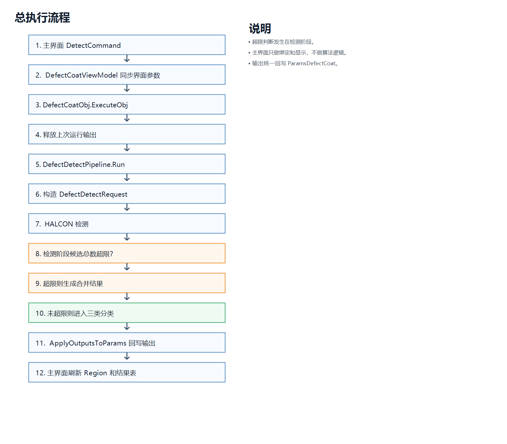
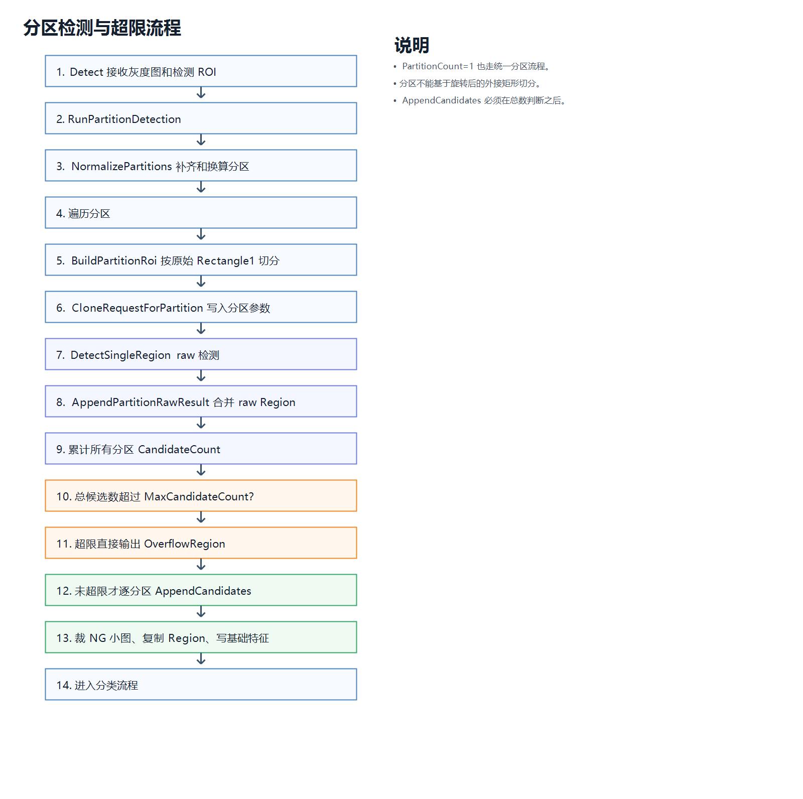
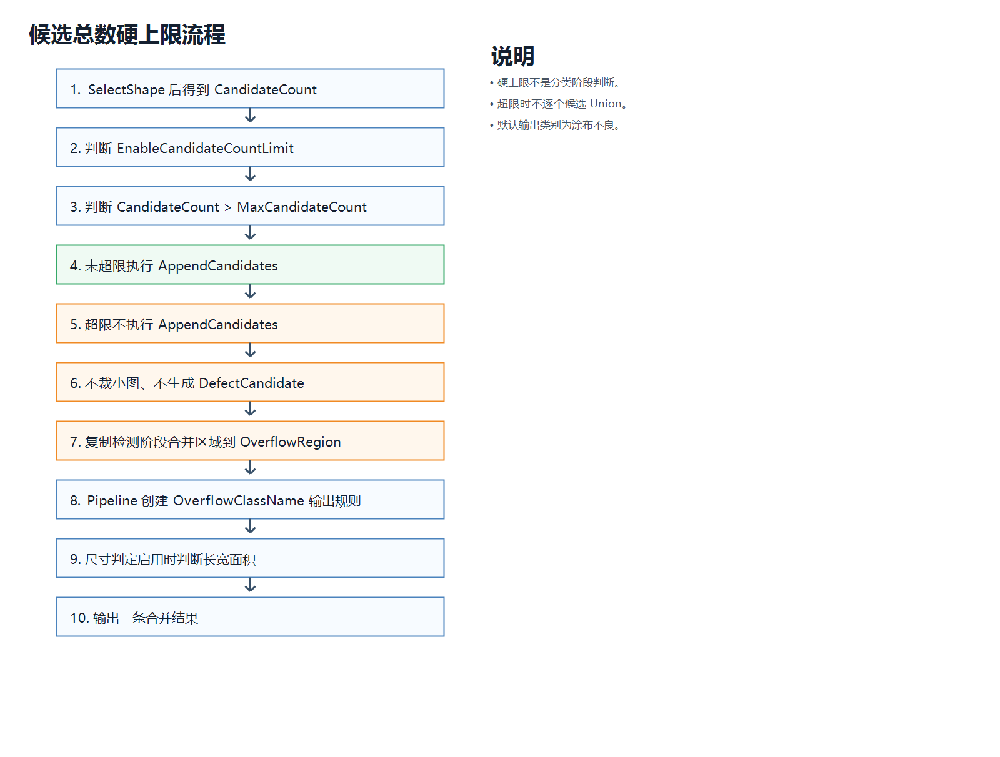
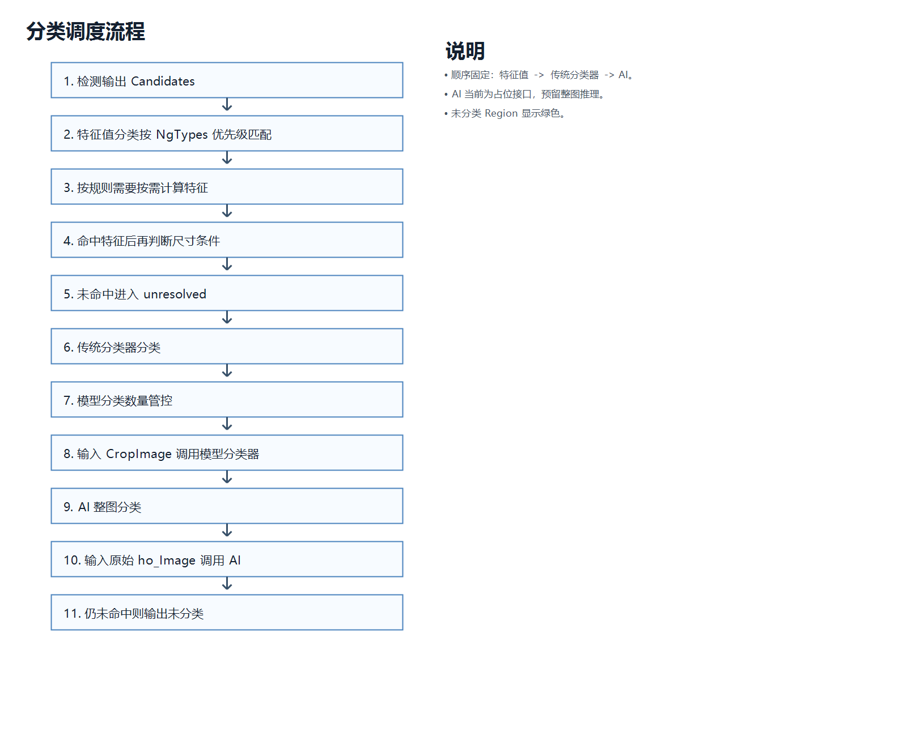
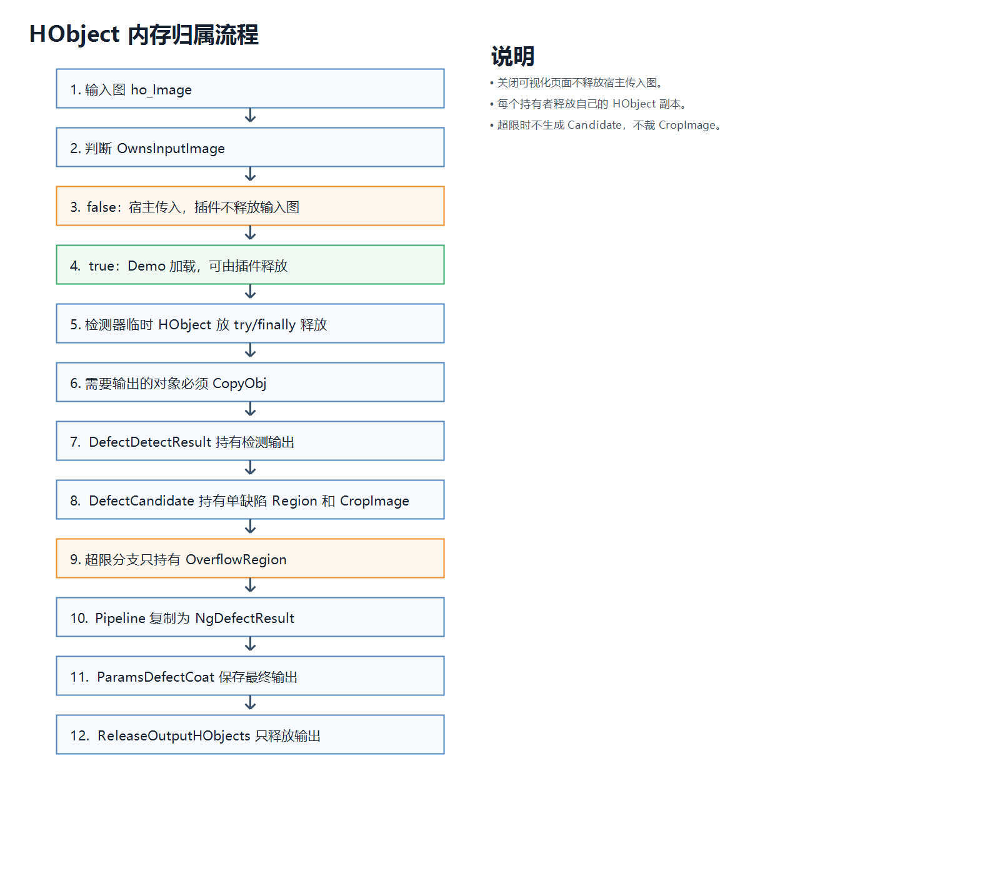

# Plugin.DefectCoat 涂布缺陷检测插件开发手册

## 1. 工程定位

测试工程目录：`D:\BaiduNetdiskDownload\宽幅打孔新方案1107\宽幅打孔新方案1017\ProcessWideHoleLaser原版测试突然出问题，暂时排查不到原因\Plugin.DefectCoat`

`Plugin.DefectCoat` 是按框架插件方式整理的涂布缺陷检测插件。页面使用 WPF + MVVM，HALCON 显示通过 `WindowsFormsHost + HWindowControl`，ROI 统一由 `ViewROI` 编辑。当前主流程是图像处理检测 + 特征值分类；传统分类器和 AI 分类已经预留独立参数、路径和初始化接口，当前不加载真实模型。

插件当前只放在框架 `test` 目录验证，不修改正式框架代码和正式插件目录；确认后再按迁移清单移动到主框架插件目录。

## 2. 目录说明

- `Models`：插件参数、ROI 参数、分区参数、插件入口对象。
- `Core/Detection`：HALCON 检测算法、位置跟随、检测请求和检测结果。
- `Core/Pipeline`：检测和三类分类器的调度流程。
- `Core/Classifiers`：特征值分类、传统分类器占位、AI 占位和独立分类参数。
- `Core/Features`：缺陷特征计算，按源程序 FeatureXXX 思路集中实现。
- `Core/Models`：缺陷候选、缺陷结果、分类规则、特征目录等核心数据对象。
- `Services`：HALCON 视窗、ViewROI 适配、默认路径服务。
- `ViewModels`：主界面和分类规则界面的 MVVM 绑定逻辑。
- `Views`：分类规则窗体、分类结果窗体。
- `ViewROI`：ROI 框架代码，当前不修改。
- `Docs`：开发手册。

## 3. 总运行链路

完整执行入口：

```text
DefectCoatViewModel.Detect()
  -> DefectCoatObj.ExecuteObj()
  -> DefectDetectPipeline.Run(...)
  -> HalconThresholdDefectDetector.Detect(...)
  -> DefectDetectPipeline.Classify(...)
  -> DefectCoatObj.ApplyOutputsToParams(...)
```

总流程图：



打开大图：[总执行流程](Images/01_main_flow.png)

分区检测具体链路：

```text
HalconThresholdDefectDetector.Detect(...)
  -> ShouldRunByPartitions(...)
  -> RunPartitionDetection(...)
  -> BuildPartitionRoi(...)
  -> CloneRequestForPartition(...)
  -> DetectSingleRegion(..., appendCandidates:false)
  -> AppendPartitionRawResult(...)
  -> 汇总所有分区 CandidateCount
  -> TryMarkCandidateCountOverflow(...)
  -> 未超限才 AppendCandidates(...)
```

`RunPartitionDetection` 是分区调度入口。当前分区流程先让每个分区执行 raw 检测，只得到亮暗阈值区域、屏蔽后的结果区域、形态学后的合并区域和候选数量；所有分区汇总后先判断候选总数硬上限。只有没有超限时，才调用 `AppendCandidates` 裁剪 NG 小图、复制单个 Region、写入基础特征。这样可以避免候选数量已经过多时仍然逐个裁图、求交和 `CopyObj`。

分区检测与超限流程图：



打开大图：[分区检测与超限流程](Images/02_partition_overflow.png)

## 4. 插件入口类

文件：`Models/DefectCoatObj.cs`

核心成员：

- `PluginParams`：类型 `ParamsDefectCoat`，主检测参数和运行输出容器。
- `LastRunResult`：类型 `DefectDetectRunResult`，最近一次检测和分类结果，下一次运行前释放。
- `FeatureRuleConfig`：类型 `FeatureRuleClassifierConfig`，当前加载的特征值分类规则。
- `ModelClassifierConfig`：类型 `ModelClassifierConfig`，传统分类器参数。
- `AiClassifierConfig`：类型 `AiClassifierConfig`，AI 参数。
- `InitMessage`：初始化状态说明。

核心方法：

- `InitObj()`：加载分类规则、传统分类器参数、AI 参数，并初始化分类对象。宿主加载参数后必须调用。
- `ExecuteObj()`：执行完整检测和分类，最后回写 `PluginParams`。
- `ClassifyLastResult()`：不重新检测，只对最近一次候选重新分类，用于 Show 分类结果。
- `SaveParams(string filePath)`：界面和 Demo 调试用保存入口，内部仍然设置 `PluginParams.filePath` 后调用 `saveParams()`，最终必须走 `PluginParamsBase.Save()`。
- `LoadParams(string filePath)`：界面读取参数用入口，内部创建 `ParamsDefectCoat` 后调用 `PluginParamsBase.Load<ParamsDefectCoat>(filePath)`，不在插件内自定义 XML 反序列化器。
- `ReleaseOutputs()`：只释放一次运行输出。
- `ReleaseRuntime()`：用于下一次执行前或框架释放插件对象时清理输出对象和 `LastRunResult`，不释放 `PluginParams.ho_Image`；单纯关闭插件可视化页面不调用它。

## 5. 主参数类

文件：`Models/PluginParam/ParamsDefectCoat.cs`

`ParamsDefectCoat` 必须继承 `Frame_Core.PluginParamsBase`。框架保存模块参数、上游传图、下游读取结果都只通过 `IPlugin.PluginParams` 这一条入口走，因此下面这些字段不能只放在 ViewModel、检测器私有字段或临时对象里。

必须放在 `PluginParamsBase` 派生类中的框架输入：

- `ho_Image`：输入图像，运行态 HObject，不写 XML；插件宿主传入的图像默认由宿主释放。
- `OwnsInputImage`：输入图像所有权标记。Demo 自己加载图像时为 `true`，插件宿主传入图像时应保持 `false`。

必须放在 `PluginParamsBase` 派生类中的框架输出：

- `ho_DetectRegion`：实际检测 ROI Region，已包含位置跟随旋转。
- `ho_ResultRegion`：全部候选缺陷 Region。
- `ho_ClassifiedRegion`：已分类 Region，界面红色显示。
- `ho_UnclassifiedRegion`：未分类 Region，界面绿色显示。
- `ho_NotMeetRegion`：命中类别但尺寸判定不达标 Region，界面橙色显示。
- `ho_MaskRoiRegion`：屏蔽 ROI 合并 Region。
- `ho_PreprocessImage`：预处理灰度图。
- `ho_DarkRegion` / `ho_LightRegion`：暗区和亮区阈值区域。
- `NgResults`：最终每个缺陷一条 `NgDefectResult`。
- `m_bRunSuccess` / `m_strRunMessage` / `m_fElapsedMs`：框架基类运行状态、运行消息和耗时，执行后必须回写。

必须放在 `PluginParamsBase` 派生类中的可保存检测参数：

- `RuleConfigPath`：分类规则入口路径。主参数只保存这一条分类入口。
- `EnableFeatureRuleClassify` / `EnableModelClassify` / `EnableAiClassify`：三类分类入口开关。
- `LocalRoi` / `MaskRois`：检测 ROI 和屏蔽 ROI。
- `PartitionCount` / `PartitionDirection` / `PartitionLengthUnit` / `Partitions`：分区数量、方向、单位和每个分区的检测参数。
- `PixelToMmH` / `PixelToMmV`：公共像素单量。
- `EnablePositionFollow`、`BaseRow`、`BaseCol`、`BaseAngle`、`CurrentRow`、`CurrentCol`、`CurrentAngle`：位置跟随参数。

不能放进 `ParamsDefectCoat` 的内容：

- `FeatureRuleClassifierConfig.NgTypes` 的规则明细。
- `ModelClassifierConfig` 的模型参数明细。
- `AiClassifierConfig` 的模型参数明细。

这些分类配置必须独立 JSON 保存，`ParamsDefectCoat` 只保留 `RuleConfigPath`。原因是后续多个检测模块要共用同一套分类逻辑，不能把规则复制进每个模块自己的主参数里。

## 6. 参数类和界面绑定转接

`CoatRoiParam`、`CoatPartitionParam` 是准备迁移到 `Frame_Core\pluginParams` 的纯参数类，所以不能继承任何界面通知基类，也不能引用插件界面层类型。`Frame_Core` 只负责保存、加载、框架传参和下游读取结果，如果在参数类里混入界面通知逻辑，后续参数公共化时会造成框架层反向依赖插件界面。

当前测试插件采用一层界面适配对象转接：

- `CoatRoiParamViewModel`：包装一个 `CoatRoiParam Model`，继承 `BindableBase`，给 WPF DataGrid 和 ROI 参数面板提供属性变更通知。
- `CoatPartitionParamViewModel`：包装一个 `CoatPartitionParam Model`，继承 `BindableBase`，给分区表格提供双向绑定、固定长度标记和刷新通知。
- `DefectCoatViewModel.MaskRoiItems`：界面绑定集合，类型是 `ObservableCollection<CoatRoiParamViewModel>`，不直接绑定 `Params.MaskRois`。
- `DefectCoatViewModel.PartitionItems`：界面绑定集合，类型是 `ObservableCollection<CoatPartitionParamViewModel>`，不直接绑定 `Params.Partitions`。

转接方向如下：

```text
框架保存 / 检测运行
  -> SyncParamsFromAdapterItems()
  -> 把 MaskRoiItems / PartitionItems 中的 Model 回写到 ParamsDefectCoat
  -> DefectCoatObj.ExecuteObj() 或 PluginParamsBase.Save()

加载参数 / 重建分区
  -> ParamsDefectCoat 是最新数据源
  -> RebuildMaskRoiItemsFromParams() / RebuildPartitionItemsFromParams()
  -> 重新生成界面适配对象
```

入口约束：

1. 保存、执行、获取 ROI、绘制 ROI 前必须调用 `SyncParamsFromAdapterItems()`，保证界面正在编辑的值落回主参数。
2. 加载参数、重建分区后必须重新生成适配集合，不能用旧界面集合覆盖刚加载的参数。
3. `CoatRoiParam` 和 `CoatPartitionParam` 内只允许保存字段、枚举、简单计算属性和 XML 序列化标记，不允许放 `ICommand`、窗口对象、控件对象或属性变更事件。
4. 后续迁移到正式框架时，`ParamsDefectCoat`、`CoatRoiParam`、`CoatPartitionParam`、`CoatNgResultParam`、`CoatFeatureItemParam` 放到 `Frame_Core\pluginParams`；`CoatRoiParamViewModel`、`CoatPartitionParamViewModel` 仍留在 `Plugin.DefectCoat\ViewModels`。
5. `ViewROI` 只负责图像窗口 ROI 编辑，不改源码；参数同步问题在 `HalconViewRoiAdapter` 和 `DefectCoatViewModel` 中处理。

分类开关：

- `EnableFeatureRuleClassify`：启用特征值分类。
- `EnableModelClassify`：启用传统分类器分类。
- `EnableAiClassify`：启用 AI 整图分类。
- `RuleConfigPath`：分类规则入口路径。主参数只保存这一条分类入口。

ROI 和分区：

- `DetectMode`：检测模式，主要使用 `LocalRoi`。
- `EditRole`：当前编辑检测 ROI 或屏蔽 ROI。
- `EnableLocalRoi`：启用检测 ROI。
- `EnableMaskRoi`：启用屏蔽 ROI。
- `EnablePositionFollow`：启用位置跟随。
- `LocalRoi`：主检测 ROI，当前统一 `Rectangle1`。
- `MaskRois`：屏蔽 ROI 列表。
- `PartitionCount`：分区数量，1 也走分区逻辑，相当于单区域检测。
- `PartitionDirection`：`LongSide` 沿 Row 方向切分，`WideSide` 沿 Col 方向切分。
- `PartitionLengthUnit`：分区长度输入显示单位，像素或毫米。
- `Partitions`：每个分区的完整检测参数。

位置跟随：

- `BaseRow` / `BaseCol` / `BaseAngle`：基准产品位置和角度。
- `CurrentRow` / `CurrentCol` / `CurrentAngle`：当前产品位置和角度。

检测默认参数：

- `ReferenceGray`：默认参考灰度。
- `UpGrayOffset` / `DownGrayOffset`：默认亮暗阈值偏移。
- `OpenRadius` / `CloseRadius`：默认开闭运算半径。
- `MinCandidateArea`：默认最小候选面积，单位 mm²。
- `EnableBackgroundGrayScale`：默认是否启用背景灰度归一化。
- `EnableSmallRegionMerge`：默认是否启用小区域合并。
- `SmallRegionMergeMaxArea`：默认小区域合并面积阈值，单位 px²。
- `SmallRegionMergeWidth` / `SmallRegionMergeHeight`：默认 `ClosingRectangle1` 尺寸。
- `MaxGrayScaleAbs`：`ScaleImage` 最大倍率绝对值。
- `PixelToMmH` / `PixelToMmV`：公共像素单量，单位 mm/pixel。

## 6. ROI 参数与位置跟随

文件：`Models/PluginParam/CoatRoiParam.cs`

核心成员：

- `Enabled`：是否启用。
- `Index`：序号。
- `Name`：名称。
- `Shape`：形状，检测主 ROI 当前固定为 `Rectangle1`。
- `Row1` / `Col1` / `Row2` / `Col2`：Rectangle1 坐标。
- `CenterRow` / `CenterCol`：中心坐标。
- `Angle`：Rectangle2 弧度角，Rectangle1 不直接使用。
- `Length1` / `Length2`：半高/半宽。
- `Radius`：圆半径，当前检测主流程不使用。

文件：`Core/Detection/DefectRoiFollowTransformer.cs`

关键方法：

- `TransformRoi(CoatRoiParam roi)`：只复制 ROI 参数，不做外接矩形转换。
- `CreateRegion(CoatRoiParam roi, out HObject region)`：生成实际检测 Region。
- `CreateRigidHomMat2d()`：用 HALCON `VectorAngleToRigid` 创建刚性变换矩阵。

位置跟随实现原则：

1. 界面仍用 `Rectangle1`，方便输入和 ViewROI 编辑。
2. 未启用位置跟随时，`CreateRegion` 使用 `GenRectangle1`。
3. 启用位置跟随时，先 `GenRectangle1`，再 `AffineTransRegion`。
4. 不允许把旋转后的四点包成最大外接矩形，否则检测区域会变大。
5. 检测 ROI、屏蔽 ROI、分区 ROI 都必须走 `DefectRoiFollowTransformer.CreateRegion`。

## 7. 分区检测

文件：`Models/PluginParam/CoatPartitionParam.cs`

每个分区的成员：

- `Index`：分区序号。
- `Name`：分区名称。
- `Enabled`：是否检测该分区。
- `IsLengthFixed`：长度是否由用户固定。
- `Length`：分区长度，单位 px。
- `LengthMm`：分区长度，单位 mm。
- `ReferenceGray`：该分区参考灰度。
- `UpGrayOffset` / `DownGrayOffset`：该分区亮暗阈值偏移。
- `OpenRadius` / `CloseRadius`：该分区开闭运算半径。
- `MinCandidateArea`：该分区最小面积，单位 mm²。
- `EnableBackgroundGrayScale`：该分区是否启用背景灰度归一化。
- `EnableSmallRegionMerge`：该分区是否启用小区域合并。
- `SmallRegionMergeMaxArea`：该分区小区域合并面积阈值。
- `SmallRegionMergeWidth` / `SmallRegionMergeHeight`：该分区 `ClosingRectangle1` 尺寸。
- `MaxGrayScaleAbs`：该分区灰度归一化倍率限制。

核心方法位置：

- `HalconThresholdDefectDetector.RunPartitionDetection(...)`：分区检测总入口。
- `NormalizePartitions(...)`：补齐分区、计算自动长度。
- `BuildPartitionRoi(...)`：根据总 ROI 和已消耗长度切出单个分区。
- `CloneRequestForPartition(...)`：把分区参数写入子请求。
- `DetectSingleRegion(...)`：单分区检测 Run。
- `AppendPartitionRawResult(...)`：合并单分区 raw 结果，只合并 Region、预处理图和日志，不接收候选对象。
- `TryMarkCandidateCountOverflow(...)`：在 `AppendCandidates` 之前判断候选总数硬上限。

分区逻辑：

1. `PartitionCount=1` 时也进入 `RunPartitionDetection`，相当于单区域检测。
2. 分区只基于原始 `Rectangle1` 坐标切分，不基于旋转后的外接框切分。
3. `LongSide` 沿 Row 方向切，固定宽度为 ROI 宽。
4. `WideSide` 沿 Col 方向切，固定宽度为 ROI 高。
5. 用户固定的分区长度不会被自动覆盖。
6. 未固定的分区长度由剩余长度平均分配。
7. 未启用分区不检测，但仍占用长度位置，后续分区不会前移。
8. 每个分区检测前都会通过 `DefectRoiFollowTransformer.CreateRegion` 做 HALCON 仿射旋转。
9. 每个分区独立执行阈值、形态学、面积筛选。
10. 所有分区先汇总候选数量，再判断是否触发硬上限。
11. 未超限时才统一执行 `AppendCandidates`，生成单个缺陷小图和候选对象。
12. 超限时直接输出检测阶段合并区域，不再逐个联合候选 Region。

## 8. 检测算法

文件：`Core/Detection/HalconThresholdDefectDetector.cs`

主入口：

- `Detect(DefectDetectRequest request)`

单分区实际检测：

- `DetectSingleRegion(HObject gray, DefectDetectRequest request, DefectRoiFollowTransformer transformer, CoatRoiParam roiParam, bool appendCandidates)`

主要步骤：

1. `Rgb1ToGray`：输入转灰度。
2. `DefectRoiFollowTransformer.CreateRegion`：生成检测 Region。
3. `BuildScaledGrayImage`：可选背景灰度归一化，对应源程序 `PretreatmentImg`。
4. `ReduceDomain`：只在检测 ROI 内处理。
5. `Threshold`：暗区 `[0, ReferenceGray - DownGrayOffset]`，亮区 `[ReferenceGray + UpGrayOffset, 255]`。
6. `MergeSmallRegion`：小区域执行 `ClosingRectangle1`，大区域不合并，避免耗时。
7. `Union2`：亮暗区域合并为总缺陷区域。
8. `ApplyMaskRois`：屏蔽 ROI 合并后从缺陷区域扣除。
9. `OpeningCircle` / `ClosingCircle`：形态学处理。
10. `Connection`：连通域。
11. `SelectShape`：按面积筛选候选。
12. `TryMarkCandidateCountOverflow`：在 `AppendCandidates` 前判断候选总数硬上限。
13. `AppendCandidates`：未超限时生成 `DefectCandidate`，裁剪 `CropImage`，保存 Region 和基础特征。

重要方法：

- `BuildScaledGrayImage(...)`：背景均值缩放到 `ReferenceGray`，倍率超过 `MaxGrayScaleAbs` 时回退 1。
- `BuildRingOutRegion(...)`：生成背景灰度统计区域。
- `MergeSmallRegion(...)`：只在最大面积小于 `SmallRegionMergeMaxArea` 时执行 `ClosingRectangle1`。
- `ApplyMaskRois(...)`：屏蔽 ROI 也走 HALCON 仿射位置跟随。
- `AppendCandidates(...)`：每个候选输出 `Region`、`CropImage`、`DarkRegion`、`LightRegion` 和基础字段；特征计算用预处理整图只放在外层 `PreprocessImage/ho_PreprocessImage`。
- `TryMarkCandidateCountOverflow(...)`：候选数量超限时直接使用检测阶段已经合并好的缺陷 Region 输出，不逐个候选 `Union2`。

### 8.1 检测算法重点说明

当前检测算法不是 AI，也不是分类器模型，它是一套 HALCON 图像处理流程。算法目标是：在指定检测 ROI 内找出亮缺陷和暗缺陷候选，输出每个缺陷的 Region、小图、亮暗子区域、基础几何信息，再交给后续分类流程。

当前代码入口必须按下面链路理解：

```text
DefectDetectPipeline.Run
  -> new DefectDetectRequest(...)
  -> HalconThresholdDefectDetector.Detect
  -> RunPartitionDetection
  -> BuildPartitionRoi
  -> CloneRequestForPartition
  -> DetectSingleRegion(..., appendCandidates:false)
  -> AppendPartitionRawResult
  -> TryMarkCandidateCountOverflow
  -> AppendCandidates
```

重点：`Detect(...)` 现在只负责准备灰度图、位置跟随对象、总 ROI，然后统一进入 `RunPartitionDetection(...)`。只要是局部 Rectangle1 检测 ROI，就会走分区检测。`PartitionCount=1` 不是另一套主检测，而是一个分区，等价于单区域检测。`AppendCandidates` 必须在候选总数硬上限判断之后调用。

### 8.2 输入图像和灰度图

入口参数来自 `DefectDetectRequest.Image`，该对象由 `DefectDetectPipeline.Run(...)` 从 `ParamsDefectCoat.ho_Image` 复制引用创建。

检测器首先判断图像是否有效：

```text
request == null
request.Image == null
request.Image 未初始化
```

任一条件不满足，检测直接返回“未加载图像”。

图像通道处理：

```text
CountChannels > 1 -> Rgb1ToGray
CountChannels = 1 -> CopyObj 得到灰度图
```

这里生成的 `gray` 是检测器内部临时图，最终在 `finally` 释放，不会释放 `Params.ho_Image`。

### 8.3 检测 ROI 和位置跟随

检测 ROI 来自：

```text
request.LocalRoi
request.EnableLocalRoi
request.DetectMode == LocalRoi
```

主 ROI 当前统一使用 `Rectangle1`。界面参数仍保存为：

```text
Row1, Col1, Row2, Col2
CenterRow, CenterCol
Length1, Length2
```

启用位置跟随时，不会把 ROI 转成旋转后的最大外接矩形。正确流程是：

```text
GenRectangle1
  -> VectorAngleToRigid
  -> AffineTransRegion
```

代码位置：

```text
DefectRoiFollowTransformer.CreateRegion
```

检测 ROI、屏蔽 ROI、分区 ROI 都必须通过这个方法生成实际 HALCON Region。这样才能保证位置跟随包含平移和角度旋转，而不是简单生成一个放大的外接矩形。

### 8.4 分区检测逻辑

分区参数来自：

```text
ParamsDefectCoat.PartitionCount
ParamsDefectCoat.PartitionDirection
ParamsDefectCoat.Partitions
```

分区入口：

```text
RunPartitionDetection(gray, transformedLocalRoi, request, transformer, result)
```

分区切分规则：

- `PartitionDirection=LongSide`：沿 Row 方向切分，也就是把 ROI 高度分段，分区宽度不变。
- `PartitionDirection=WideSide`：沿 Col 方向切分，也就是把 ROI 宽度分段，分区高度不变。
- `PartitionCount=1`：只生成一个分区，等价于单区域检测。
- 未启用的分区不检测，但仍占用长度位置，后续分区不会往前补位。
- 用户手动固定的分区长度不会被自动覆盖。
- 未固定的分区长度由剩余长度平均分配。

代码中切分单分区 ROI 的方法：

```text
BuildPartitionRoi(...)
```

该方法只在原始 `Rectangle1` 坐标内切分，不做旋转。旋转跟随仍交给：

```text
DefectRoiFollowTransformer.CreateRegion
```

原因：如果先把总 ROI 旋转成外接矩形再分区，分区长度、位置、面积都会变大，检测结果会偏离真实 ROI。

### 8.5 单分区检测 Run

真正执行图像处理的是：

```text
DetectSingleRegion(...)
```

每个分区都会执行同一套步骤：

```text
1. CreateRegion 生成实际 ROI Region
2. BuildScaledGrayImage 生成归一化灰度图
3. ReduceDomain 限定检测区域
4. Threshold 得到暗区域和亮区域
5. MergeSmallRegion 小区域合并
6. Union2 合并亮暗区域
7. ApplyMaskRois 扣除屏蔽 ROI
8. OpeningCircle 去小噪声
9. ClosingCircle 连接邻近区域
10. Connection 连通域
11. SelectShape 按面积筛选
12. AppendCandidates 输出候选缺陷
```

分区之间的检测参数是独立的。`CloneRequestForPartition(...)` 会把当前分区的参数写入子请求：

```text
ReferenceGray
UpGrayOffset
DownGrayOffset
OpenRadius
CloseRadius
MinCandidateArea
EnableBackgroundGrayScale
EnableSmallRegionMerge
SmallRegionMergeMaxArea
SmallRegionMergeWidth
SmallRegionMergeHeight
MaxGrayScaleAbs
```

所以设置了多个分区后，不存在所谓“主检测参数覆盖所有分区”。实际运行以每个分区自己的参数为准。

### 8.6 背景灰度归一化

对应源程序 `PretreatmentImg` 中的灰度缩放思路。代码位置：

```text
BuildScaledGrayImage(...)
BuildRingOutRegion(...)
```

启用条件：

```text
request.EnableBackgroundGrayScale == true
```

关闭时：

```text
scaledGray = gray.CopyObj(1, -1)
Scale = 1.000000
```

启用时流程：

```text
1. 生成背景区域 background
2. Intensity(background, gray) 求背景平均灰度 mean
3. scale = ReferenceGray / mean
4. 如果 Abs(scale) > MaxGrayScaleAbs，则回退 scale = 1.0
5. ScaleImage(gray, scale, 0)
```

背景区域生成规则：

- 没有 ROI：使用整图 Domain。
- ROI 多连通域：按源程序思路取 `SelectObj(2)` 作为背景区域。
- ROI 单连通域：使用 `GetDomain(gray) - roi` 作为背景区域。

输出信息写入：

```text
DefectDetectResult.PreprocessInfo
DefectDetectResult.DebugLogs
ParamsDefectCoat.ho_PreprocessImage
```

### 8.7 亮暗阈值逻辑

阈值中心是 `ReferenceGray`。

暗缺陷阈值：

```text
darkMax = ReferenceGray - DownGrayOffset
Threshold(reduced, 0, darkMax)
```

亮缺陷阈值：

```text
lightMin = ReferenceGray + UpGrayOffset
Threshold(reduced, lightMin, 255)
```

生成结果：

```text
dark  -> 暗区域
light -> 亮区域
union -> 亮暗合并总缺陷区域
```

每个候选最终会保存：

```text
candidate.DarkRegion
candidate.LightRegion
candidate.Polarity
```

`Polarity` 的判断是比较亮区面积和暗区面积：

```text
lightArea >= darkArea -> 亮缺陷
否则 -> 暗缺陷
```

### 8.8 小区域合并逻辑

代码位置：

```text
MergeSmallRegion(ref HObject region, ...)
```

该逻辑对齐源程序：

```csharp
// 只对小的缺陷执行合并区域，大缺陷不执行区域合并（太耗时）
if (hRegDefect.Area.TupleMax() < 1000 && hRegDefect.Area.TupleMax() != 0)
{
    hRegDefect = hRegDefect.ClosingRectangle1(3, 3);
}
```

Demo 中开放成参数：

```text
EnableSmallRegionMerge
SmallRegionMergeMaxArea
SmallRegionMergeWidth
SmallRegionMergeHeight
```

判断规则：

```text
未启用 -> 不合并
区域为空 -> 不合并
最大区域面积 <= 0 -> 不合并
最大区域面积 >= SmallRegionMergeMaxArea -> 不合并
最大区域面积 < SmallRegionMergeMaxArea -> ClosingRectangle1(width, height)
```

这样做的原因是：小碎区域可以通过矩形闭运算连接邻近缺陷；大缺陷如果也做合并，会明显增加耗时，还可能把本不该连在一起的区域合并。

### 8.9 屏蔽 ROI 逻辑

屏蔽 ROI 来自：

```text
request.MaskRois
request.EnableMaskRoi
```

代码位置：

```text
ApplyMaskRois(...)
```

流程：

```text
1. 遍历启用的 MaskRoi
2. 每个 MaskRoi 通过 DefectRoiFollowTransformer.CreateRegion 生成实际 Region
3. 多个屏蔽 Region 通过 Union2 合并
4. Difference(缺陷区域, 总屏蔽区域)
5. 输出 maskUnionRegion 给界面显示
```

注意：屏蔽 ROI 也必须走位置跟随。如果检测 ROI 跟随角度旋转，而屏蔽 ROI 不旋转，会导致屏蔽区域和产品实际位置错位。

### 8.10 面积筛选和单位换算

界面参数 `MinCandidateArea` 单位是 `mm²`，但 HALCON `SelectShape(area)` 使用像素面积。

换算逻辑：

```text
areaScale = PixelToMmH * PixelToMmV
minAreaPx = MinCandidateArea / areaScale
SelectShape(connected, "area", "and", minAreaPx, 999999999)
```

基础输出字段：

```text
area      = areaPx * PixelToMmH * PixelToMmV
length    = max(widthMm, heightMm)
width     = min(widthMm, heightMm)
height    = heightMm
row/col   = AreaCenter 输出的像素坐标
mean_gray = Intensity 输出的灰度均值
```

这些字段服务于结果列表和尺寸判定。分类特征使用 `FeatureCatalog` 中的 `Feature.*` 键，不要把基础字段误认为完整分类特征。

### 8.11 候选缺陷输出

代码位置：

```text
AppendCandidates(...)
WriteBaseFeatures(...)
```

每个候选会保存：

```text
Region       单缺陷 Region
CropImage    裁剪好的 NG 小图
DarkRegion   当前缺陷与暗区域交集
LightRegion  当前缺陷与亮区域交集
InvalidRegion 屏蔽区域副本
Features     基础字段缓存
```
特征计算用灰度图不放在单个候选里，统一使用外层 `DetectResult.PreprocessImage` 或 `Params.ho_PreprocessImage`，避免每个缺陷都复制一份整图。

为什么检测阶段就裁 `CropImage`：

- 传统分类器分类需要单个 NG 小图。
- 结果界面需要显示每个缺陷的小图。
- 后续替换真实分类器时，不需要重新回到原图裁剪。

为什么要 `CopyObj(1, -1)`：

- 检测器内部临时 HObject 会在 `finally` 中释放。
- 输出对象必须持有自己的 HObject 副本。
- 否则外层显示或分类时会访问到已释放对象。

## 9. 检测请求和结果

文件：`Core/Detection/DefectDetectRequest.cs`

这是 Pipeline 和检测器之间的输入边界。`DefectDetectPipeline.Run` 从 `ParamsDefectCoat` 拷贝参数生成该对象，检测器只依赖 `DefectDetectRequest`。

文件：`Core/Detection/DefectDetectResult.cs`

关键成员：

- `Success`：检测是否成功。
- `Message`：检测信息。
- `Candidates`：检测候选 `DefectCandidate` 列表。
- `RoiRegion`：检测 ROI Region。
- `MaskRoiRegion`：屏蔽 ROI Region。
- `ResultRegion`：候选缺陷合并 Region。
- `PreprocessImage`：预处理图。
- `DarkRegion` / `LightRegion`：暗/亮阈值区域。
- `DebugLogs`：算法调试日志。

文件：`Core/Models/DefectCandidate.cs`

候选缺陷包含：

- `Index`：候选序号。
- `Polarity`：亮缺陷或暗缺陷。
- `Region`：单个缺陷 Region。
- `CropImage`：进入分类前裁剪好的 NG 小图。
- 特征计算用图像：不在单个候选里保存，由外层 `DetectResult.PreprocessImage` 传入特征上下文。
- `DarkRegion` / `LightRegion` / `InvalidRegion`：候选关联区域。
- `Features`：基础字段缓存和分类特征缓存。
- `WidthPx` / `HeightPx`：候选外接框像素宽高。
- `PixelToMmH` / `PixelToMmV`：当前候选使用的像素单量。
- `ReferenceGray`：当前候选参考灰度。

## 10. 分类流程

文件：`Core/Pipeline/DefectDetectPipeline.cs`

主入口：

- `Run(ParamsDefectCoat parameters, FeatureRuleClassifierConfig featureConfig, ModelClassifierConfig modelConfig)`

分类入口：

- `Classify(...)`

分类顺序：

1. 特征值分类：`SpecRuleClassifier`
2. 传统分类器分类：`IModelDefectClassifier`
3. AI 整图分类：`IAiDefectClassifier`
4. 仍未命中则输出“未分类”

特征值分类：

- `RunFeatureRuleClassify(...)`：特征分类入口。
- `EnableCandidateCountLimit / MaxCandidateCount`：候选总数硬超限，整批合并输出 `OverflowClassName`。
- `EnableMaxEnterClassifyLimit / MaxEnterClassifyCount`：未硬超限时只取面积最大的前 N 个进入特征分类。
- `ClassifyByFeatureRule(...)`：调用 `SpecRuleClassifier`。

传统分类器分类：

- 受 `ParamsDefectCoat.EnableModelClassify` 控制。
- 模型路径来自 `ModelClassifierConfig.ModelPath`。
- 当前实现是 `ModelClassifierPlaceholder`，后续替换即可。
- 输入是单个候选的 `CropImage`。

AI 分类：

- 受 `ParamsDefectCoat.EnableAiClassify` 控制。
- 模型路径来自 `AiClassifierConfig.ModelPath`。
- 当前实现是 `AiClassifierPlaceholder`。
- 预留输入是原始整图 `ho_Image` 和候选列表。

## 11. 特征值分类规则

文件：`Core/Classifiers/SpecRuleClassifier.cs`

规则匹配方式：

1. `FeatureRuleClassifierConfig.NgTypes` 的顺序就是优先级。
2. 每个 `NgTypeRule` 表示一种 NG 类型。
3. 每个 `NgTypeRule.Features` 只配置该类别需要的特征范围。
4. 分类时不会先计算所有特征，只会按当前类别配置的 `FeatureRule` 逐项取值。
5. `GetFeatureValue` 先查 `DefectFeatureBag` 缓存；没有缓存时调用 `DefectFeatureExtractor.GetFeatureValue`。
6. 特征全部命中后，如果 `EnableJudgeCondition=false`，直接输出当前类别。
7. 如果 `EnableJudgeCondition=true`，再判断长、宽、面积是否满足 `JudgeCondition`。
8. 尺寸未达标时，类别仍是当前类别，结果来源为“未达到设定要求”，Region 显示橙色。

规则对象：

- `FeatureRuleClassifierConfig`：分类规则独立参数入口。
- `NgTypeRule`：单个 NG 类型规则。
- `FeatureRule`：单个特征范围，包含 `FeatureType`、`MinValue`、`MaxValue`。
- `FeatureCatalog`：特征名称、特征 Key、说明和建议范围。
- `PicFeatureType`：可选特征枚举。

### 11.1 分类规则重点说明

特征值分类不是“每个缺陷先算全部特征再分类”。当前逻辑是按源程序思路做按需计算：

```text
一个候选缺陷
  -> 按 NgTypes 优先级逐个尝试类别
  -> 每个类别只读取自己配置的 FeatureRule
  -> 特征范围全部通过
  -> 如果启用尺寸判定，再判断长/宽/面积
  -> 输出类别
```

真正分类入口：

```text
DefectDetectPipeline.Classify
  -> RunFeatureRuleClassify
  -> ClassifyByFeatureRule
  -> SpecRuleClassifier.Classify
```

规则窗口编辑的是：

```text
FeatureRuleClassifierConfig
  -> NgTypes
      -> NgTypeRule
          -> Features
              -> FeatureRule
```

### 11.2 NgTypes 是优先级列表

`FeatureRuleClassifierConfig.NgTypes` 是当前生效的 NG 类型规则列表。

运行分类时：

```csharp
foreach (NgTypeRule rule in context.NgTypes)
```

列表越靠前，优先级越高。只要某个类别命中并通过尺寸判定，就直接返回该类别，不再继续判断后面的类别。

举例：

```text
NgTypes[0] = 黑点
NgTypes[1] = 脏污
NgTypes[2] = 涂布不良
```

如果某个缺陷同时满足“黑点”和“脏污”的特征范围，最终会输出“黑点”，因为黑点在前面。

规则窗口里的上移/下移按钮，本质就是调整 `NgTypes` 顺序，也就是调整分类优先级。

### 11.3 DarkNgTypes 当前不参与分类

`DarkNgTypes` 是旧参数兼容字段。当前运行链路没有把它传给 `SpecRuleClassifier`，也没有界面绑定它。

当前生效规则只有：

```text
FeatureRuleClassifierConfig.NgTypes
```

如果后续删除 `DarkNgTypes`，当前分类结果不受影响；但要同步删除所有拷贝代码和文档说明。如果要恢复“暗缺陷单独规则表”，则必须在 `DefectDetectPipeline` 或 `SpecRuleClassifier` 中明确选择暗缺陷时使用 `DarkNgTypes`。

### 11.4 NgTypeRule 表示一个类别

`NgTypeRule` 是一个 NG 类别，例如：

```text
黑点
白点
划伤
气泡
涂布不良
```

核心字段：

- `Name`：命中后输出的类别名称。
- `EnableJudgeCondition`：是否启用尺寸判定。
- `JudgeCondition`：尺寸判定组合方式。
- `MinLength / MaxLength`：长度范围，单位 mm。
- `MinWidth / MaxWidth`：宽度范围，单位 mm。
- `MinArea / MaxArea`：面积范围，单位 mm²。
- `Features`：该类别需要判断的特征范围集合。

尺寸判定不是必须启用。关闭时，只看 `Features` 是否命中。

### 11.5 FeatureRule 表示一个特征范围

`FeatureRule` 是单个特征条件：

```text
FeatureType：选择哪个特征
MinValue：允许最小值
MaxValue：允许最大值
```

界面中看到的中文名、说明、建议范围来自 `FeatureCatalog`：

```text
FeatureName             中文显示名
FeatureKey              特征缓存 Key
FeatureDescription      特征计算说明
FeatureRangeDescription 建议范围和单位
```

示例：

```text
类别：黑点
特征：暗区平均值
范围：0 ~ 80
```

分类时会读取当前候选的“暗区平均值”，如果值在 0 到 80 之间，这条特征条件通过。

当前范围判断代码是：

```text
value < MinValue 或 value > MaxValue -> 不通过
否则 -> 通过
```

也就是包含边界：`MinValue <= value <= MaxValue`。

### 11.6 按需获取特征值

代码位置：

```text
SpecRuleClassifier.MatchFeatures
SpecRuleClassifier.GetFeatureValue
DefectFeatureExtractor.GetFeatureValue
```

流程：

```text
1. 读取当前类别 rule.Features
2. 遍历每条 FeatureRule
3. 根据 FeatureType 找 FeatureCatalog 中的 FeatureKey
4. 先在 candidate.Features 缓存中查 FeatureKey
5. 如果缓存没有，再调用 DefectFeatureExtractor.GetFeatureValue 计算
6. 计算完成写回 candidate.Features
7. 判断是否落在 MinValue~MaxValue
```

这样做的原因：

- 正常分类只计算规则需要的特征，减少耗时。
- 手动“获取全部特征”按钮才计算全部特征，方便调规则。
- `DefectFeatureBag` 是缓存，避免同一缺陷同一特征重复计算。

### 11.7 尺寸判定逻辑

代码位置：

```text
SpecRuleClassifier.MatchJudgeCondition
```

尺寸判定读取的是检测阶段已经写入的基础字段：

```text
length
width
area
```

不会触发全部特征计算，也不会解析字符串公式。

四种判定方式：

```text
所有条件且：长度通过 && 宽度通过 && 面积通过
所有条件或：长度通过 || 宽度通过 || 面积通过
(长&&宽)||面积：(长度通过 && 宽度通过) || 面积通过
(长||宽)&&面积：(长度通过 || 宽度通过) && 面积通过
```

当前判断范围使用：

```text
value > min && value < max
```

注意这里是开区间，不包含边界。也就是说长度刚好等于最小值或最大值时，会判定为未通过。这个行为来自当前代码，如果现场希望包含边界，应把 `IsBetween` 改成：

```text
value >= min && value <= max
```

### 11.8 特征命中和尺寸未达标的结果

分类顺序是：

```text
先判断 FeatureRule
再判断尺寸 JudgeCondition
```

如果特征没有命中：

```text
继续判断下一个 NgTypeRule
```

如果特征命中了，但尺寸判定未通过：

```text
ClassName = 当前类别名
Source = 未达到设定要求
HitRule = 记录哪项尺寸未通过
```

界面显示颜色约定：

```text
已分类 -> 红色
未分类 -> 绿色
未达到设定要求 -> 橙色
```

这样做的目的：现场能看出该缺陷像某个类别，但没有达到该类别设置的尺寸要求。

### 11.9 数量超限分类逻辑

代码位置：

```text
DefectDetectPipeline.Run
HalconThresholdDefectDetector.Detect
HalconThresholdDefectDetector.RunPartitionDetection
HalconThresholdDefectDetector.TryMarkCandidateCountOverflow
FeatureRuleClassifierConfig.CreateOverflowRuleForRuntime
```

第一层：候选总数硬上限。

```text
EnableCandidateCountLimit = true
且候选数量 > MaxCandidateCount
```

处理方式：

```text
1. 检测阶段在 SelectShape 后先统计候选数量
2. 如果候选数量超过 MaxCandidateCount，不调用 AppendCandidates
3. 不裁 NG 小图，不生成单个 DefectCandidate，不逐个求交和 CopyObj
4. 直接使用检测阶段已经合并好的亮暗缺陷区域作为 OverflowRegion
5. Pipeline 根据 OverflowClassName 生成本次运行输出规则，默认“涂布不良”
6. 输出一个合并结果后结束本次分类流程
```

这里的关键点是：硬上限必须发生在检测阶段，而不是 `RunFeatureRuleClassify`。如果已经进入 `RunFeatureRuleClassify`，说明 `AppendCandidates` 已经执行过，单个候选的小图、Region 和亮暗子区域也已经复制出来了，此时再判断硬上限就失去了“减少耗时和内存”的意义。

分区检测时也不能按单分区分别判断硬上限。正确流程是：

```text
每个分区 raw 检测
  -> 汇总所有分区 CandidateCount
  -> 总数超过 MaxCandidateCount
  -> 直接使用所有分区合并后的 OverflowRegion
```

超限时不用把每个候选再 `Union2` 一遍，因为数量过多时逐个联合本身就会增加耗时。当前实现直接复用检测阶段已经完成阈值、屏蔽 ROI、形态学后的合并区域。

候选总数硬上限流程图：



打开大图：[候选总数硬上限流程](Images/03_candidate_limit.png)

第二层：最多进入分类数量。

```text
EnableMaxEnterClassifyLimit = true
且候选数量 > MaxEnterClassifyCount
```

处理方式：

```text
1. 按候选 area 从大到小排序
2. 只取面积最大的前 N 个进入特征分类
3. 剩余候选不进入特征分类
4. 剩余候选直接按 OverflowClassName 输出
```

这两层的区别：

```text
硬上限：检测阶段整批不生成单个候选，直接输出一个合并结果。
进入限制：前 N 个进入特征分类，其余单个按超限类别输出。
```

`OverflowClassName` 对应规则也可以启用尺寸判定。如果启用后尺寸不达标，结果来源会显示“未达到设定要求”。

### 11.10 传统分类器和 AI 的位置

特征值分类后仍未分类的候选，会继续进入后续分类方式：

```text
特征值分类未命中
  -> 传统分类器分类
  -> AI 整图分类
  -> 未分类
```

分类调度流程图：



打开大图：[分类调度流程](Images/04_classification_flow.png)

传统分类器：

- 受 `Params.EnableModelClassify` 控制。
- 参数来自 `ModelClassifierConfig`。
- 输入是每个候选的 `CropImage`。
- 也有“整批硬上限”和“最多进入分类器数量”。
- 当前实现是 `ModelClassifierPlaceholder`，后续替换真实分类器即可。

AI 分类：

- 受 `Params.EnableAiClassify` 控制。
- 参数来自 `AiClassifierConfig`。
- 输入是原始整图 `ho_Image` 和候选列表。
- 当前实现是 `AiClassifierPlaceholder`。
- AI 不做 NG 小图数量限制，因为它预留为全图推理。

### 11.11 未分类输出

如果候选经过所有已启用分类方式仍未命中，则输出：

```text
ClassName = 未分类
Source = 未分类
HitRule = 已启用的分类方式均未命中，或对应分类对象仍为占位实现。
```

界面上未分类 Region 显示绿色。

常见原因：

- 没有启用任何分类方式。
- 特征值分类没有配置任何 NG 类型。
- 当前候选不满足任何特征范围。
- 传统分类器或 AI 仍是占位实现。
- 分类器路径未配置或模型未接入。

### 11.12 分类规则配置建议

建议配置顺序：

```text
1. 先运行检测，确认候选 Region 和小图正确。
2. 在特征输出界面选择典型缺陷。
3. 点击“获取全部特征用于分类”。
4. 查看该缺陷的所有特征值。
5. 到分类规则窗口新增类别。
6. 选择 1~3 个区分度高的特征作为 FeatureRule。
7. 设置 MinValue / MaxValue。
8. 如果需要尺寸管控，再启用尺寸判定。
9. 调整 NgTypes 顺序，让更明确的类别排前面。
10. 保存规则，触发主界面重新 InitObj。
```

不要一开始给每个类别配置太多特征。特征越多，命中条件越苛刻，也越容易把本该分类的缺陷打成未分类。

## 12. 分类规则参数

文件：`Core/Classifiers/FeatureRuleClassifierConfig.cs`

核心成员：

- `ConfigPath`：特征规则 XML 路径。
- `ModelClassifierConfigPath`：传统分类器参数 XML 路径。
- `AiClassifierConfigPath`：AI 参数 XML 路径。
- `EnableCandidateCountLimit`：特征分类候选总数硬超限开关。
- `MaxCandidateCount`：特征分类硬超限数量。
- `EnableMaxEnterClassifyLimit`：最多进入特征分类数量开关。
- `MaxEnterClassifyCount`：最多进入特征分类数量。
- `OverflowClassName`：超限输出类别，默认“涂布不良”。
- `NgTypes`：NG 类型规则列表，顺序即优先级。
- `DarkNgTypes`：兼容保留列表。

运行时超限规则：

- 普通加载、打开规则窗体、保存规则时不会自动生成“涂布不良”。
- 只有运行分类触发数量超限时才调用 `CreateOverflowRuleForRuntime()`，它只生成运行时特殊输出规则，不插入普通优先级规则列表。
- 如果 `NgTypes` 中不存在 `OverflowClassName`，运行时创建一次并写入当前规则集合。
- 创建前按名称去重，避免重复打开/保存后多出多个同名标签。

## 13. 分类规则窗体

文件：

- `Views/RuleSettingsWindow.xaml`
- `ViewModels/RuleSettingsViewModel.cs`

用途：

1. 独立编辑特征规则。
2. 显示和设置规则保存路径。
3. 保存特征规则 XML、传统分类器 XML、AI 参数 XML。
4. 保存成功后触发 `RuleSettingsViewModel.Saved`。
5. 主界面收到事件后执行 `InitObj()` 重新加载分类对象。

主要命令：

- `AddNgTypeCommand` / `DeleteNgTypeCommand`：增删 NG 类型。
- `MoveNgUpCommand` / `MoveNgDownCommand`：调整优先级。
- `AddFeatureCommand` / `DeleteFeatureCommand`：增删特征条件。
- `SelectPathCommand`：设置特征规则保存路径。
- `ImportCommand`：加载其他模块的分类规则。
- `SaveCommand`：保存分类规则和关联参数。
- `SelectModelConfigPathCommand` / `SelectModelFilePathCommand`：设置传统分类器参数和模型路径。
- `SelectAiConfigPathCommand` / `SelectAiModelPathCommand`：设置 AI 参数和模型路径。

## 14. 特征输出和手动获取全部特征

正常运行流程不计算所有特征，避免耗时。特征输出界面的“获取全部特征”按钮用于调试和配置规则：

1. 选择一个检测结果。
2. 点击获取全部特征。
3. ViewModel 调用 `DefectFeatureExtractor` 对当前缺陷计算全部 `PicFeatureType`。
4. 显示当前缺陷名、分类类型、所有特征名称、特征值和说明。

这个按钮只服务调试和规则配置，不改变正常分类流程。

## 15. 输出对象和内存管理

每个 `NgDefectResult` 保存：

- `Region`：单个缺陷 Region。
- `CropImage`：单个缺陷小图。
- 特征计算图像：使用外层 `Params.ho_PreprocessImage` 或 `DetectResult.PreprocessImage`，单个缺陷不持有整图副本。
- `DarkRegion` / `LightRegion` / `InvalidRegion`：关联区域。
- `Features`：基础字段和已计算特征。

内存释放规则：

- `ParamsDefectCoat.ReleaseOutputHObjects()`：释放运行输出，不释放输入图像。
- `ParamsDefectCoat.ReleaseOwnedInputImage()`：仅当 `OwnsInputImage=true` 时释放输入图像。
- `ParamsDefectCoat.ReleaseOwnedRuntimeHObjects()`：释放运行输出，并且只释放本模块拥有的输入图像。
- `DefectCoatObj.ReleaseRuntime()`：用于下一次 `ExecuteObj()` 运行前或框架释放插件对象时清理运行输出，不释放宿主传入的 `ho_Image`。单纯关闭插件可视化页面只释放显示控件和预览适配器，不主动释放运行输出。
- `DefectDetectRunResult.Dispose()`：释放检测结果和最终结果列表。
- `NgDefectResult.Dispose()` 和 `DefectCandidate.Dispose()`：释放单缺陷 HObject。
- 写入最终结果时使用 `CopyObj(1, -1)`，避免外层释放后内部对象失效。

HObject 归属流程图：



打开大图：[HObject 内存归属流程](Images/05_memory_flow.png)

超限分支的内存规则：

```text
候选总数超限
  -> 不生成 DefectCandidate
  -> 不裁 CropImage
  -> DefectDetectResult.OverflowRegion 持有合并输出区域
  -> Pipeline 复制 OverflowRegion 生成 NgDefectResult
  -> Dispose 时由 DefectDetectResult 和 NgDefectResult 分别释放自己的副本
```

## 16. UI 和绑定

主窗口：

- 文件：`MainWindow.xaml`
- ViewModel：`DefectCoatViewModel`

HALCON 显示：

- `WindowsFormsHost`
- `HalconDotNet.HWindowControl`
- `HalconViewRoiAdapter`
- `ViewROI.HWndCtrl`
- `ViewROI.ROIController`

重要命令：

- `LoadImageCommand`：加载图像。
- `DrawRoiCommand`：绘制/刷新 ROI。
- `GetRoiDataCommand`：同步 ROI 参数。
- `DetectCommand`：执行检测。
- `ShowClassifyCommand`：显示分类结果窗口。
- `ShowRuleSettingsCommand`：打开分类规则窗口。
- `GetAllFeaturesCommand`：手动获取当前缺陷全部特征。
- `SaveParamsCommand` / `LoadParamsCommand`：保存/加载主参数。
- `AddMaskRoiCommand` / `DeleteMaskRoiCommand`：维护屏蔽 ROI。
- `RebuildPartitionsCommand` / `NormalizePartitionsCommand`：生成和换算分区。

## 17. 数值控件 NumericBox

文件：`Controls/NumericBox.cs`

用途：

`NumericBox` 是 Demo 里统一使用的 WPF 数值输入控件，用来替代普通 `TextBox`，支持：

- `Value`：绑定的 double 数值。
- `Minimum` / `Maximum`：最小值和最大值。
- `Increment`：上下箭头步进。
- `DecimalPlaces`：提交后显示的小数位数。

本次重点修改：

原先 `OnTextChanged(...)` 会在用户输入过程中实时解析文本并写回 `Value`。`Value` 变化后会触发 `OnValueChanged(...)`，然后 `ApplyValue(...)` 立刻把文本格式化成固定小数位。这样输入 `1000.000` 这类 double 时，输入过程中的中间状态会被反复格式化，造成光标跳动、选区变化，甚至出现 `0001` 这类数字顺序错乱。

现在改成“编辑过程不打断、提交时再格式化”：

1. `OnTextChanged(...)` 只做合法性检查，不再实时写回 `Value`。
2. `OnValueChanged(...)` 如果发现当前正在手动编辑，并且不是提交阶段，就不刷新文本框。
3. 只有回车、失去焦点、点击上下箭头时才调用 `CommitText()`。
4. `CommitText()` 统一解析文本、限制范围、四舍五入、写回 `Value`，最后按 `DecimalPlaces` 格式化显示。

关键字段：

- `editing`：用户正在编辑文本框时为 true。
- `committing`：正在执行提交时为 true，提交期间允许 `Value` 回调刷新文本。
- `syncing`：程序主动刷新文本时为 true，避免 TextChanged 递归触发。

关键方法：

- `OnPreviewTextInput(...)`：输入前校验字符是否合法。
- `OnTextChanged(...)`：编辑中只校验，不提交。
- `OnValueChanged(...)`：外部绑定更新时刷新显示；手动编辑中不抢文本。
- `CommitText()`：提交文本到 `Value`。
- `Step(int direction)`：上下箭头步进，先提交当前文本，再加减步进值。
- `ApplyValue(double value)`：按小数位格式化显示。

开发注意：

- 对需要输入小数的参数，必须使用 `DecimalPlaces > 0`。
- 对整数参数，例如分区数量、候选数量限制，使用 `DecimalPlaces=0`。
- 不要在 `OnTextChanged(...)` 中重新加入实时 `SetCurrentValue(ValueProperty, parsed)`，否则会再次出现输入 double 时光标乱跳的问题。
- 如果后续要做实时绑定预览，应另加 `PreviewValue` 或延迟提交机制，不要破坏当前提交式输入逻辑。

## 18. 类写法规范

这一节说明后续开发者新增或修改类时应该怎么写。原则是：参数只负责保存，检测器只负责算法，Pipeline 只负责调度，ViewModel 只负责界面绑定，HALCON 对象必须明确所有权和释放位置。

### 18.1 参数类写法

代表类：

- `ParamsDefectCoat`
- `CoatPartitionParam`
- `CoatRoiParam`
- `FeatureRuleClassifierConfig`
- `ModelClassifierConfig`
- `AiClassifierConfig`

写法要求：

1. 参数类只放可保存、可加载、可绑定的字段，不写具体算法。
2. 需要 XML 保存的字段必须是 public 属性。
3. `HObject`、结果列表、运行状态这类运行期对象必须加 `[XmlIgnore]`，必要时加 `[NonSerialized]`。
4. 每个 public 成员必须写中文注释，说明单位、用途、输入还是输出。
5. 像素单量这类公共参数只放在 `ParamsDefectCoat`，不要在分区参数里重复保存。
6. 分类规则参数必须独立成 `FeatureRuleClassifierConfig`，主参数只保存 `RuleConfigPath`。

示例：

```csharp
/// <summary>最小候选面积，单位 mm²。运行时会根据像素单量换算成 px²。</summary>
public double MinCandidateArea { get; set; }
```

不推荐：

```csharp
// 不要在参数类里直接写 HALCON 阈值、连通域、分类判断等算法。
public void Detect() { ... }
```

### 18.2 运行请求类写法

代表类：

- `DefectDetectRequest`

作用：

`DefectDetectRequest` 是 `ParamsDefectCoat` 到检测器之间的运行快照。Pipeline 创建它，检测器只读它。这样检测器不依赖界面，也不直接依赖插件主参数对象。

写法要求：

1. 字段名尽量和 `ParamsDefectCoat` 对应，方便追踪来源。
2. 不要在 `DefectDetectRequest` 里保存最终结果。
3. 不要在检测器里反向修改 `ParamsDefectCoat`。
4. 如果新增检测参数，应同步修改：
   - `ParamsDefectCoat`
   - `DefectDetectRequest`
   - `DefectDetectPipeline.Run`
   - 分区参数 `CoatPartitionParam`，如果该参数需要按分区独立设置
   - `RuleSettingsWindow` 或 `MainWindow` 绑定界面

新增参数流程：

```text
ParamsDefectCoat 新增默认值
  -> DefectDetectRequest 新增运行字段
  -> DefectDetectPipeline.Run 赋值
  -> HalconThresholdDefectDetector 使用
  -> MainWindow.xaml 绑定控件
  -> Docs 开发手册补说明
```

### 18.3 ROI 类写法

代表类：

- `CoatRoiParam`
- `DefectRoiFollowTransformer`
- `HalconViewRoiAdapter`

写法要求：

1. 界面编辑统一用 `CoatRoiParam`。
2. 主检测 ROI 当前必须是 `Rectangle1`。
3. 不要把位置跟随后旋转的 ROI 写回 `CoatRoiParam.Row1/Col1/Row2/Col2`。
4. 运行时必须用 `DefectRoiFollowTransformer.CreateRegion` 生成 HALCON Region。
5. 启用位置跟随时必须用 HALCON：
   - `VectorAngleToRigid`
   - `AffineTransRegion`
6. 不允许用旋转后四点的最大外接矩形代替旋转 ROI。

正确方式：

```csharp
transformer.CreateRegion(roiParam, out HObject roiRegion);
```

禁止方式：

```csharp
// 禁止：旋转四个角点后再取 min/max 生成 Rectangle1。
// 这会把检测范围变大。
```

### 18.4 检测器类写法

代表类：

- `IDefectDetector`
- `HalconThresholdDefectDetector`
- `DefectDetectResult`
- `DefectCandidate`

检测器职责：

1. 输入图像转灰度。
2. 生成检测 ROI 和屏蔽 ROI。
3. 执行预处理、阈值、区域合并、形态学、连通域、面积筛选。
4. 在生成候选对象前判断候选总数硬上限。
5. 未超限时输出候选缺陷 `DefectCandidate`。
6. 超限时输出合并 Region，不生成单个候选对象。
7. 不做最终类别判断。

写法要求：

1. 检测器不访问 ViewModel。
2. 检测器不弹窗。
3. 检测器不保存 XML。
4. 检测器不写界面控件状态。
5. 检测器输出的 HObject 必须由结果对象持有，并在 `Dispose` 中释放。
6. 临时 HObject 必须放在 `try/finally` 里释放。
7. 需要输出给外层的 HObject 必须 `CopyObj(1, -1)`。
8. `AppendCandidates` 必须放在候选数量硬上限判断之后。
9. 超限输出不能再逐个候选 `Union2`，应复用检测阶段已合并的缺陷 Region。

单分区检测入口：

```csharp
private static DefectDetectResult DetectSingleRegion(..., bool appendCandidates)
```

分区调度入口：

```csharp
private static void RunPartitionDetection(...)
```

新增检测步骤时的推荐位置：

- 图像归一化：放在 `BuildScaledGrayImage`。
- ROI 相关：放在 `DefectRoiFollowTransformer` 或 `ApplyMaskRois`。
- 小区域合并：放在 `MergeSmallRegion`。
- 候选基础字段：放在 `AppendCandidates` 和 `WriteBaseFeatures`。
- 候选总数硬上限：放在 `TryMarkCandidateCountOverflow`，调用点必须在 `AppendCandidates` 前。

### 18.5 分区检测类写法

代表类和方法：

- `CoatPartitionParam`
- `RunPartitionDetection`
- `NormalizePartitions`
- `BuildPartitionRoi`
- `CloneRequestForPartition`
- `DetectSingleRegion`
- `AppendPartitionRawResult`
- `TryMarkCandidateCountOverflow`

写法要求：

1. `PartitionCount=1` 就是单区域检测，不再写另一套主检测 Run。
2. 分区参数必须完整包含检测算法需要调的参数。
3. 分区不保存像素单量，统一使用 `ParamsDefectCoat.PixelToMmH/PixelToMmV`。
4. 分区先在原始 `Rectangle1` 坐标中切分，再用 HALCON 仿射旋转。
5. 未启用分区仍占用长度位置，后续分区不能前移。
6. 所有分区必须先 raw 检测并汇总候选总数。
7. 总数未超限时，才把所有分区结果合并为一份候选列表，再进入分类。
8. 总数超限时，直接输出合并 Region，不生成候选列表。

新增一个分区参数时必须同步：

```text
CoatPartitionParam 添加属性
  -> ParamsDefectCoat 默认参数可选添加
  -> CreateDefaultPartition 赋默认值
  -> CloneRequestForPartition 写入子请求
  -> DetectSingleRegion raw 检测字段可选同步
  -> MainWindow.xaml 分区表格绑定
  -> Docs 开发手册补成员说明
```

### 18.6 Pipeline 类写法

代表类：

- `DefectDetectPipeline`
- `DefectDetectRunResult`

职责：

1. 把 `ParamsDefectCoat` 转成 `DefectDetectRequest`。
2. 调用 `IDefectDetector.Detect`。
3. 按顺序调度特征值分类、传统分类器、AI 分类。
4. 把候选结果转成 `NgDefectResult`。

写法要求：

1. Pipeline 不直接写界面。
2. Pipeline 不保存参数。
3. Pipeline 不负责 HALCON 阈值算法。
4. Pipeline 接收检测阶段的候选总数硬上限标记，并负责组装最终超限输出。
5. Pipeline 可以做传统分类器和进入分类数量限制这类分类调度管控。
6. 三类分类器必须保持独立开关和独立配置来源。

分类顺序固定：

```text
特征值分类 -> 传统分类器分类 -> AI 整图分类 -> 未分类
```

不要把 AI 或传统分类器逻辑写进 `SpecRuleClassifier`。

### 18.7 分类器类写法

代表类：

- `IDefectClassifier`
- `SpecRuleClassifier`
- `IModelDefectClassifier`
- `ModelClassifierPlaceholder`
- `IAiDefectClassifier`
- `AiClassifierPlaceholder`

特征值分类器写法：

1. 只读取当前类别配置的 `FeatureRule`。
2. 不默认计算所有特征。
3. 按 `NgTypes` 顺序匹配，顺序就是优先级。
4. 命中特征范围后，再根据 `EnableJudgeCondition` 判断尺寸条件。
5. 尺寸不达标时输出当前类别，但 `Source` 为“未达到设定要求”。

传统分类器写法：

1. 参数来自 `ModelClassifierConfig`。
2. 模型路径来自 `ModelClassifierConfig.ModelPath`。
3. 输入应使用单个候选的 `CropImage`。
4. 模型分类阶段的数量超限逻辑在 Pipeline 中做，不在模型对象中做。
5. 特征值分类的候选总数硬上限不在这里处理，它已经前移到检测阶段。

AI 分类写法：

1. 参数来自 `AiClassifierConfig`。
2. 模型路径来自 `AiClassifierConfig.ModelPath`。
3. 输入是原始整图和候选列表。
4. AI 不走 NG 小图数量限制。

### 18.8 特征类写法

代表类：

- `PicFeatureType`
- `FeatureCatalog`
- `FeatureRule`
- `DefectFeatureExtractor`
- `DefectFeatureBag`
- `FeatureValueRow`

新增一个特征必须同步：

```text
PicFeatureType 添加枚举
  -> FeatureCatalog 添加中文名、FeatureKey、说明、建议范围
  -> DefectFeatureExtractor.GetFeatureValue 添加计算分支
  -> 手动获取全部特征界面自动显示
  -> 分类规则界面可选择该特征
```

写法要求：

1. 特征 Key 统一由 `FeatureCatalog.KeyOf(type)` 生成。
2. 基础输出字段使用 `area/length/width/row/column` 等普通 key。
3. 分类特征使用 `Feature.*` key。
4. `DefectFeatureBag` 是缓存，不是随机填值容器。
5. 分类运行时只按规则需要的特征计算。
6. 手动获取全部特征按钮才计算所有特征。

### 18.9 结果类写法

代表类：

- `NgDefectResult`
- `DefectCandidate`
- `DefectFeatureSummaryRow`
- `FeatureValueRow`

写法要求：

1. 单个缺陷的小图和 Region 必须放在对应缺陷对象中。
2. 外层只保存总 Region 和结果列表。
3. `NgDefectResult.Region` 是最终输出缺陷区域。
4. `NgDefectResult.CropImage` 是该缺陷小图。
5. `NgDefectResult.Features` 是该缺陷的特征缓存。
6. 结果对象实现 `Dispose` 时必须释放所有内部 HObject。
7. UI 行对象不应持有复杂算法逻辑，只做显示转换。

### 18.10 ViewModel 类写法

代表类：

- `DefectCoatViewModel`
- `RuleSettingsViewModel`
- `BindableBase`
- `RelayCommand`

写法要求：

1. ViewModel 负责命令、绑定、状态文本、集合刷新。
2. ViewModel 可以调用插件对象，但不要写 HALCON 检测算法。
3. 所有按钮必须通过 `ICommand`。
4. 所有可调参数必须双向绑定到参数对象。
5. 窗体之间通过事件或传参通信，避免互相直接操作内部控件。
6. `RuleSettingsViewModel.Saved` 保存后通知主界面重新 `InitObj()`。

新增按钮流程：

```text
ViewModel 添加 ICommand
  -> 构造函数绑定 RelayCommand
  -> XAML Button 绑定 Command
  -> 方法内部只调服务/插件/参数，不直接写算法
```

### 18.11 服务类写法

代表类：

- `HalconViewRoiAdapter`
- `HalconPreviewAdapter`
- `DefaultConfigPathService`
- `HalconMouseInfoArgs`

写法要求：

1. 服务类封装外部框架或重复操作。
2. `HalconViewRoiAdapter` 只做 HWindowControl、ViewROI、参数之间的同步。
3. `HalconPreviewAdapter` 只做小图/Region 预览，不参与检测。
4. `DefaultConfigPathService` 只负责默认路径，不加载业务规则。
5. 服务类需要释放资源时实现 `IDisposable`。

### 18.12 窗体和 XAML 写法

代表文件：

- `MainWindow.xaml`
- `Views/RuleSettingsWindow.xaml`
- `Views/ClassifyResultWindow.xaml`

写法要求：

1. 不在 XAML 后台写业务算法。
2. XAML 只做布局和绑定。
3. 数值输入统一用 `NumericBox`。
4. 字符串选项用 `ComboBox`。
5. 列表用 `DataGrid` 或 `ItemsControl`。
6. 图像显示必须使用 `WindowsFormsHost + HWindowControl`。
7. 不要把多个功能挤到同一块面板里；分区、ROI、过滤条件、结果显示要分组。

### 18.13 新增功能检查清单

新增检测参数：

- `ParamsDefectCoat` 是否有默认值和注释。
- `DefectDetectRequest` 是否添加运行字段。
- `DefectDetectPipeline.Run` 是否赋值。
- `CoatPartitionParam` 是否需要同步。
- `CreateDefaultPartition` 和 `CloneRequestForPartition` 是否同步。
- XAML 是否有绑定控件。
- 文档是否补说明。

新增分类方式：

- 是否新增接口或实现类。
- 是否有独立参数类。
- 是否有模型路径。
- 是否在 `InitObj()` 初始化。
- 是否在 `DefectDetectPipeline.Classify` 中调度。
- 是否有启用开关。
- 是否说明输入图像还是 NG 小图。

新增输出字段：

- `DefectCandidate` 是否保存。
- `NgDefectResult` 是否保存。
- `CloneResult` 是否复制。
- `Dispose` 是否释放 HObject。
- UI 表格是否显示。
- 文档是否说明单位。

新增 HALCON 对象：

- 是否明确所有权。
- 是否需要 `CopyObj(1, -1)`。
- 是否在 `finally` 或 `Dispose` 释放。
- 是否避免把临时对象直接交给外层保存。

## 19. 后续集成为插件

### 19.1 Frame_Core 同步约束

`Plugin.DefectCoat` 与 `Plugin.MeasureLine` 对齐的框架入口如下：

- `DefectCoatObj : IPlugin`：插件对象，MEF 导出名 `DefectCoatObj`。
- `PluginParamsBase PluginParams`：框架唯一主参数入口，实际对象是 `ParamsDefectCoat`。
- `SetParams(PluginParamsBase param)`：框架加载 XML 后把参数传回插件，这里必须转换为 `ParamsDefectCoat`。
- `IniObj()`：框架初始化入口，负责按 `Params.RuleConfigPath` 加载分类规则、传统分类器参数和 AI 参数。
- `ExecuteObj()`：框架运行入口，必须从 `Params.ho_Image` 取输入图，输出写回 `PluginParams`。
- `saveParams()`：框架保存入口，保存 `ParamsDefectCoat`；主界面保存时会先同步保存分类规则独立 XML。
- `GetResultParams(string varName, object obj)`：把 `NgResults`、Region、耗时等输出注册给宿主流程。
- `DisPoseObj()`：框架释放插件对象入口，只释放运行输出，不释放宿主传入的 `Params.ho_Image`。

框架集成时最容易出错的是把数据放错地方：

- 图像输入必须写入 `((ParamsDefectCoat)plugin.PluginParams).ho_Image`。
- 检测结果必须从 `plugin.PluginParams` 读，特别是 `NgResults` 和各类 `ho_*Region`。
- 分类规则明细不要写入 `ParamsDefectCoat`，只写 `RuleConfigPath`。
- 规则窗口可以修改独立分类 XML，但保存后必须触发 `InitObj()`，否则运行对象仍然拿旧规则。

### 19.2 公共分类库拆分清单

分类规则后续要抽到公共库，给其他工具复用。建议公共库命名类似 `DefectRuleClassifier.Core`，至少包含下面文件。

分类参数和分类器接口：

- `Core/Classifiers/FeatureRuleClassifierConfig.cs`：特征值分类独立参数，包含 `NgTypes`、优先级、数量限制、模型参数路径和 AI 参数路径。
- `Core/Classifiers/ModelClassifierConfig.cs`：传统分类器独立参数，包含模型路径、候选数量硬上限、进入分类器数量上限。
- `Core/Classifiers/AiClassifierConfig.cs`：AI 分类独立参数，包含 AI 模型路径和备注。
- `Core/Classifiers/IDefectClassifier.cs`：特征值分类器接口。
- `Core/Classifiers/IModelDefectClassifier.cs`：传统分类器接口，输入是缺陷小图。
- `Core/Classifiers/IAiDefectClassifier.cs`：AI 分类接口，输入是原始整图和候选列表。
- `Core/Classifiers/SpecRuleClassifier.cs`：特征值分类实现，按 `NgTypes` 顺序和特征范围匹配。
- `Core/Classifiers/DefectClassifyContext.cs`：特征值分类上下文。
- `Core/Classifiers/DefectClassifyDecision.cs`：分类结果决策对象。

分类规则模型：

- `Core/Models/NgTypeRule.cs`：单个缺陷类别规则，包含类别名、尺寸判定、特征规则集合。
- `Core/Models/FeatureRule.cs`：单个特征范围条件，包含特征类型、最小值、最大值。
- `Core/Models/JudgeConditionMode.cs`：尺寸判定组合方式。
- `Core/Models/JudgeConditionModeOption.cs`：尺寸判定界面选项。
- `Core/Models/JudgeConditionTemplate.cs`：尺寸判定模板，兼容旧 XML 和界面显示。
- `Core/Models/PicFeatureType.cs`：全部可选特征枚举。
- `Core/Models/FeatureCatalog.cs`：特征中文名、Key、说明和范围说明。
- `Core/Models/FeatureTypeOption.cs`：规则界面 ComboBox 使用的特征选项。
- `Core/Models/DefectFeatureBag.cs`：缺陷特征缓存，按需计算后写入。

分类运行所需缺陷对象：

- `Core/Models/DefectCandidate.cs`：检测阶段输出给分类器的候选缺陷，包含 Region、小图、亮暗区域和基础几何数据。
- `Core/Models/NgDefectResult.cs`：最终分类输出，包含类别、来源、命中规则、小图、Region 和全部基础特征。
- `Core/Features/DefectFeatureExtractor.cs`：按 `PicFeatureType` 计算特征值，对应源程序 `GetFeatureValue` 和 `FeatureXXX` 方法。

可选放入公共 UI 库的规则编辑界面：

- `Views/RuleSettingsWindow.xaml`
- `Views/RuleSettingsWindow.xaml.cs`
- `ViewModels/RuleSettingsViewModel.cs`

公共库不应依赖 `ParamsDefectCoat`、`DefectCoatObj`、`HalconThresholdDefectDetector` 或主界面 ViewModel。检测插件只负责产生 `DefectCandidate`，公共分类库只负责按配置分类并返回 `NgDefectResult` 或分类决策。

### 19.3 宿主调用示例

建议宿主调用顺序：

```csharp
var plugin = new DefectCoatObj();
plugin.PluginParams = DefectCoatObj.LoadParams(paramPath);
plugin.IniObj();
var p = (ParamsDefectCoat)plugin.PluginParams;
p.ho_Image = image;
p.OwnsInputImage = false;
bool ok = plugin.ExecuteObj();
var results = p.NgResults;
plugin.saveParams();
plugin.DisPoseObj(); // 独立调用场景结束时释放输出；框架集成时通常由宿主生命周期调用。
```

集成注意点：

1. 宿主传入图像时 `OwnsInputImage=false`，由宿主负责释放；只有插件内部自己加载或创建的输入图才允许置为 `true` 并由插件释放。
2. 主参数只保存 `RuleConfigPath`，分类规则 XML 独立保存。
3. 多个模块可共用同一套 `FeatureRuleClassifierConfig`。
4. 修改规则后要调用 `InitObj()` 重新加载分类对象。
5. 真实传统分类器接入时替换 `ModelClassifierPlaceholder`。
6. 真实 AI 接入时替换 `AiClassifierPlaceholder`。
7. 位置跟随只通过 `BaseRow/BaseCol/BaseAngle` 和 `CurrentRow/CurrentCol/CurrentAngle` 控制，不修改 Rectangle1 参数本身。

## 20. 构建验证

构建命令：

```powershell
dotnet build "D:\BaiduNetdiskDownload\宽幅打孔新方案1107\宽幅打孔新方案1017\ProcessWideHoleLaser原版测试突然出问题，暂时排查不到原因\DefectRuleClassifier\DefectRuleClassifier.csproj" -c Release -p:Platform=x64
& "C:\Program Files\Microsoft Visual Studio\2022\Community\MSBuild\Current\Bin\MSBuild.exe" "D:\BaiduNetdiskDownload\宽幅打孔新方案1107\宽幅打孔新方案1017\ProcessWideHoleLaser原版测试突然出问题，暂时排查不到原因\Plugin.DefectCoat\Plugin.DefectCoat.csproj" /p:Configuration=Release /p:Platform=x64 /m
```

启动：

```powershell
插件工程输出为 DLL，由框架宿主加载；当前 DLL 输出到：
`D:\BaiduNetdiskDownload\宽幅打孔新方案1107\宽幅打孔新方案1017\ProcessWideHoleLaser原版测试突然出问题，暂时排查不到原因\Mef_VisionFrame\bin\Release\Plugins\Plugin.DefectCoat.dll`
```

当前已知警告：`ViewROI/HWndCtrl.cs` 原始代码有未使用字段和不可达代码警告，未修改 `ViewROI`，不影响 Demo 运行。

## 21. 调试排查重点

这一节用于现场或后续开发快速定位问题。

### 21.1 检测不到缺陷

优先检查：

```text
1. 主图是否成功加载 ho_Image。
2. 检测 ROI 是否覆盖真实产品区域。
3. 分区是否启用。
4. ReferenceGray 是否接近背景灰度。
5. UpGrayOffset / DownGrayOffset 是否过大。
6. MinCandidateArea 是否过大。
7. 屏蔽 ROI 是否把缺陷区域扣掉。
```

对应界面：

- 主图窗口：看 ROI 和结果叠加。
- 预处理/阈值图：看暗区、亮区、NG 区域。
- 算法调试页：看阈值、连通域数量、面积筛选数量。

对应代码：

```text
HalconThresholdDefectDetector.DetectSingleRegion
BuildScaledGrayImage
Threshold
SelectShape
AppendCandidates
```

### 21.2 候选太多或耗时变长

优先检查：

```text
1. UpGrayOffset / DownGrayOffset 是否过小，导致大量背景被阈值选中。
2. MinCandidateArea 是否过小。
3. EnableSmallRegionMerge 是否启用。
4. SmallRegionMergeMaxArea 是否设置过大。
5. OpenRadius / CloseRadius 是否过大。
6. 分区数量是否过多。
7. 特征分类是否启用了过多复杂特征。
```

数量过多时，分类前还有两层保护：

```text
FeatureRuleConfig.EnableCandidateCountLimit
FeatureRuleConfig.EnableMaxEnterClassifyLimit
ModelClassifierConfig.EnableCandidateCountLimit
ModelClassifierConfig.EnableMaxEnterClassifierLimit
```

如果触发超限，结果会按 `OverflowClassName` 输出，默认“涂布不良”。

### 21.3 分区位置不对

优先检查：

```text
1. PartitionDirection 是长向分段还是宽向分段。
2. RoiWidth / RoiHeight 是否和总矩形显示一致。
3. Length / LengthMm 是否被用户固定。
4. PixelToMmH / PixelToMmV 是否正确。
5. EnablePositionFollow 是否启用。
6. BaseAngle / CurrentAngle 是否正确。
```

关键原则：

```text
分区先按原始 Rectangle1 切分，再通过 HALCON AffineTransRegion 做位置跟随。
不能用旋转后的最大外接矩形分区。
```

对应代码：

```text
RunPartitionDetection
NormalizePartitions
BuildPartitionRoi
CloneRequestForPartition
DefectRoiFollowTransformer.CreateRegion
```

### 21.4 分类结果总是未分类

优先检查：

```text
1. Params.EnableFeatureRuleClassify 是否启用。
2. FeatureRuleConfig.NgTypes 是否为空。
3. 当前类别是否配置了 FeatureRule。
4. FeatureRule.MinValue / MaxValue 是否包含当前缺陷特征值。
5. 是否启用了尺寸判定且尺寸未通过。
6. 传统分类器和 AI 是否仍是占位实现。
```

排查方法：

```text
1. 在输出结果表选中缺陷。
2. 打开特征输出页。
3. 点击“获取全部特征用于分类”。
4. 对比规则窗口中该类别的特征范围。
5. 查看 HitRule 字段说明。
```

对应代码：

```text
SpecRuleClassifier.MatchFeatures
SpecRuleClassifier.GetFeatureValue
DefectFeatureExtractor.GetFeatureValue
SpecRuleClassifier.MatchJudgeCondition
```

### 21.5 显示“未达到设定要求”

这不是未分类，也不是算法异常。含义是：

```text
该缺陷已经命中了某个类别的特征范围，
但该类别启用了尺寸判定，
长/宽/面积没有满足设置范围。
```

输出规则：

```text
ClassName = 命中的类别名
Source = 未达到设定要求
Region 颜色 = 橙色
```

排查：

```text
1. 查看该类别 EnableJudgeCondition 是否启用。
2. 查看 JudgeCondition 是 且 / 或 / (长&&宽)||面积 / (长||宽)&&面积。
3. 查看 HitRule 中长度、宽度、面积哪一项未通过。
4. 确认 PixelToMmH / PixelToMmV 是否正确。
```

### 21.6 NG 小图模糊或显示不对

当前小图来自：

```text
AppendCandidates -> CropRectangle1(scaledGray, row1, col1, row2, col2)
```

也就是说小图裁的是预处理后的灰度图 `scaledGray`，不是彩色原图。

如果看起来模糊或对比不明显，检查：

```text
1. 是否启用了背景灰度归一化。
2. scaledGray 是否经过 ScaleImage。
3. 缺陷外接框是否太小。
4. 小图窗口是否 Fit 过度拉伸。
```

后续如果分类器需要原始图小图，可以在 `DefectCandidate` 中额外保存原图裁剪结果，但要同步处理 HObject 释放。

### 21.7 参数保存后没有生效

主参数和分类规则是分开的：

```text
ParamsDefectCoat 保存检测参数和 RuleConfigPath。
FeatureRuleClassifierConfig 保存特征分类规则。
ModelClassifierConfig 保存传统分类器参数。
AiClassifierConfig 保存 AI 参数。
```

规则窗口点击保存后会触发：

```text
RuleSettingsViewModel.Saved
  -> 主界面复制规则
  -> plugin.InitObj()
```

如果直接手动改 XML 或外部覆盖文件，必须重新调用 `InitObj()`，否则内存里的分类对象还是旧规则。
## 插件集成速查

### 框架入口

- 插件对象：`Models/DefectCoatObj.cs`
- 插件页面：`WPF架构/DefectCoatUser.xaml`、`WPF架构/DefectCoatUser.xaml.cs`
- 页面 ViewModel：`ViewModels/DefectCoatViewModel.cs`
- 主参数：`Models/PluginParam/ParamsDefectCoat.cs`
- 检测流程：`Core/Detection/HalconThresholdDefectDetector.cs`
- 分类调度：`Core/Pipeline/DefectDetectPipeline.cs`
- 特征值分类器：`Core/Classifiers/SpecRuleClassifier.cs`
- 分类规则独立参数：`Core/Classifiers/FeatureRuleClassifierConfig.cs`

`DefectCoatObj` 实现 `Frame_Core.IPlugin`，MEF 导出名为 `DefectCoatObj`。框架加载后按下面顺序使用：

```text
宿主创建插件对象
  -> SetParams(ParamsDefectCoat)
  -> IniObj()
  -> ExecuteObj()
  -> GetResultParams(...)
  -> saveParams()
  -> DisPoseObj()
```

`DefectCoatUser` 实现 `IPluginWpfView`。宿主 WPF 插件窗口只需要调用 `BindPlugin`、`RunFromHost`、`SaveFromHost`、`CloseFromHost`，不要在窗体层写检测逻辑。

### 主参数输入

`ParamsDefectCoat` 中参与运行的主要输入如下：

- `ho_Image`：输入图像。插件宿主传入时 `OwnsInputImage=false`，本插件不释放。
- `LocalRoi`：检测 ROI，当前统一 `Rectangle1`。
- `MaskRois`：屏蔽 ROI 列表，运行时合并后从候选区域扣除。
- `PartitionCount`：分区数量。设置为 1 时就是单区域检测，多于 1 时仍走统一分区流程。
- `PartitionDirection`：分区方向，`LongSide` 沿高度切分，`WideSide` 沿宽度切分。
- `Partitions`：每个分区自己的检测参数，包括 `ReferenceGray`、`UpGrayOffset`、`DownGrayOffset`、`OpenRadius`、`CloseRadius`、`MinCandidateArea`、小区域合并参数等。
- `PixelToMmH` / `PixelToMmV`：公共像素单量，单位 mm/px。分区长度选择毫米输入时用它换算。
- `EnablePositionFollow`、`BaseRow`、`BaseCol`、`BaseAngle`、`CurrentRow`、`CurrentCol`、`CurrentAngle`：位置跟随输入，运行时通过 HALCON 刚性仿射变换生成当前 ROI。
- `EnableFeatureRuleClassify`、`EnableModelClassify`、`EnableAiClassify`：三类分类入口开关。
- `RuleConfigPath`：分类规则入口路径。主参数只保存这个路径，具体规则、传统分类器参数和 AI 参数都在独立 XML 中维护。

### 主参数输出

`ExecuteObj()` 运行后会回写以下输出：

- `NgResults`：最终缺陷结果列表，每个缺陷一行。
- `ho_DetectRegion`：实际检测区域。
- `ho_ResultRegion`：全部候选缺陷合并区域。
- `ho_ClassifiedRegion`：已分类区域，界面红色显示。
- `ho_UnclassifiedRegion`：未分类区域，界面绿色显示。
- `ho_NotMeetRegion`：命中类别但尺寸判定未达要求区域，界面橙色显示。
- `ho_MaskRoiRegion`：屏蔽 ROI 合并区域。
- `ho_PreprocessImage`：预处理灰度图。
- `ho_DarkRegion` / `ho_LightRegion`：暗缺陷、亮缺陷阈值区域。
- `m_bRunSuccess`、`m_strRunMessage`、`m_fElapsedMs`：框架基类运行状态和耗时。

### NgResults 内容

`NgResults` 的元素类型是 `NgDefectResult`。每个对象包含：

- `Index`：缺陷序号。
- `ClassName`：分类类型，例如黑点、白点、涂布不良、未分类。
- `Source`：分类来源，例如特征值分类、分类器分类、AI分类、未达到设定要求。
- `HitRule`：命中规则或未命中原因。
- `Area`、`Length`、`Width`、`Height`：默认输出的面积、长、宽、高，单位 mm 或 mm²。
- `Row`、`Column`：缺陷中心位置，单位 px。
- `MeanGray`、`Polarity`：平均灰度和亮暗极性。
- `Features`：缺陷特征缓存。规则分类按需取特征，界面“获取所有特征”按钮会补齐全部特征。
- `Region`：当前缺陷自己的 NG Region。
- `CropImage`：进入传统分类器前裁好的缺陷小图。
- 特征计算图像：不再作为 `NgDefectResult` 成员保存，统一从外层 `Params.ho_PreprocessImage` 传入。
- `DarkRegion`、`LightRegion`、`InvalidRegion`：当前缺陷内部的暗区、亮区和无效区域。
- `WidthPx`、`HeightPx`、`PixelToMmH`、`PixelToMmV`、`ReferenceGray`：特征复算所需的辅助数据。

### 检测算法流程

`HalconThresholdDefectDetector.Detect()` 只负责检测，不负责分类：

```text
输入 ho_Image
  -> RGB 转灰度或复制灰度图
  -> 根据 LocalRoi 和位置跟随生成当前检测 ROI
  -> 按 PartitionCount 和 PartitionDirection 切分 Rectangle1
  -> 每个分区读取自己的阈值、过滤、小区域合并参数
  -> 可选背景灰度归一化
  -> 暗阈值 + 亮阈值
  -> 暗区和亮区合并
  -> 小缺陷合并 ClosingRectangle1
  -> 屏蔽 ROI 扣除
  -> 开闭运算
  -> Connection + SelectShape 面积筛选
  -> 每个缺陷裁剪 CropImage 并保存 Region
```

分区统一处理，没有额外“主检测参数”分支。`PartitionCount=1` 时就是一个分区，效果等同单区域检测；`PartitionCount>1` 时先逐分区检测，最后合并候选，再进入分类。

### 分类流程

`DefectDetectPipeline.Classify()` 是三类分类的统一调度入口：

1. 特征值分类：由 `SpecRuleClassifier` 根据 `FeatureRuleClassifierConfig.NgTypes` 顺序匹配。列表越靠前优先级越高。每个类别只读取该类别配置的 `FeatureRule`，不会默认给每个缺陷计算全部特征。启用尺寸判定时，只有特征规则命中后才判断 `JudgeConditions`。
2. 传统分类器分类：由 `ModelClassifierPlaceholder` 预留。进入前已经准备好 `candidate.CropImage`，后续替换真实分类器时直接用小图和模型路径即可。
3. AI 分类：由 `AiClassifierPlaceholder` 预留。AI 入口接收原始整图 `ho_Image` 和候选列表，后续替换真实 AI 推理对象。

特征值分类和传统分类器分类都有两层数量限制：

- `EnableCandidateCountLimit` / `MaxCandidateCount`：候选总数超过硬上限时，整批不进入该分类器，合并为一条涂布不良输出。
- `EnableMaxEnterClassifyLimit` 或 `EnableMaxEnterClassifierLimit`：总数没有超过硬上限时，只允许面积最大的前 N 个进入分类，其余按涂布不良输出。

运行时如果规则里没有 `OverflowClassName` 指向的类别，`FeatureRuleClassifierConfig.CreateOverflowRuleForRuntime()` 会临时生成“涂布不良”规则用于输出，不要求用户提前手动添加。

### 分类规则保存

分类规则界面使用独立参数类，不把规则明细塞进 `ParamsDefectCoat`：

- `FeatureRuleClassifierConfig`：特征值分类规则、优先级、数量限制、传统分类器参数路径、AI 参数路径。
- `ModelClassifierConfig`：传统分类器模型路径、数量限制、进入分类器数量限制。
- `AiClassifierConfig`：AI 模型路径和备注。

主界面保存时调用 `DefectCoatViewModel.SaveFromHost()` 或保存按钮，保存顺序为：

```text
保存 ModelClassifierConfig
  -> 保存 AiClassifierConfig
  -> 保存 FeatureRuleClassifierConfig
  -> 保存 ParamsDefectCoat
```

规则窗口点击保存会触发 `RuleSettingsViewModel.Saved` 事件，主页面注册该事件后调用 `DefectCoatObj.InitObj()` 重新加载分类对象。窗口关闭时会注销事件，避免重复注册导致保存后多触发。

### 内存归属

- `Params.ho_Image` 是输入图像，宿主传入时本插件不能释放。
- Demo 页面自己加载图像时会设置 `OwnsInputImage=true`，只有再次手动换图时才释放自己拥有的旧输入图像；加载参数不释放、不替换 `ho_Image`。
- `ExecuteObj()` 每次运行前调用 `Params.ReleaseOutputHObjects()` 和 `LastRunResult.Dispose()`，只释放上一次输出。
- `NgDefectResult.Dispose()` 释放单个缺陷持有的 `Region`、`CropImage`、`DarkRegion`、`LightRegion`、`InvalidRegion`；预处理整图由外层 `DetectResult/Params` 统一释放。
- `DisPoseObj()` 释放运行态输出，不释放宿主输入图像。插件可视化页面关闭只释放 `HWindowControl`、`HalconViewRoiAdapter`、预览适配器等显示资源，不主动释放 `NgResults`、`ho_ResultRegion` 等运行输出；旧输出会在下一次 `ExecuteObj()` 前释放。

### 编译命令

```powershell
dotnet build "D:\BaiduNetdiskDownload\宽幅打孔新方案1107\宽幅打孔新方案1017\ProcessWideHoleLaser原版测试突然出问题，暂时排查不到原因\DefectRuleClassifier\DefectRuleClassifier.csproj" -c Release -p:Platform=x64
& "C:\Program Files\Microsoft Visual Studio\2022\Community\MSBuild\Current\Bin\MSBuild.exe" "D:\BaiduNetdiskDownload\宽幅打孔新方案1107\宽幅打孔新方案1017\ProcessWideHoleLaser原版测试突然出问题，暂时排查不到原因\Plugin.DefectCoat\Plugin.DefectCoat.csproj" /p:Configuration=Release /p:Platform=x64 /m
```

输出 DLL：

```text
D:\BaiduNetdiskDownload\宽幅打孔新方案1107\宽幅打孔新方案1017\ProcessWideHoleLaser原版测试突然出问题，暂时排查不到原因\Mef_VisionFrame\bin\Release\Plugins\Plugin.DefectCoat.dll
D:\BaiduNetdiskDownload\宽幅打孔新方案1107\宽幅打孔新方案1017\ProcessWideHoleLaser原版测试突然出问题，暂时排查不到原因\Mef_VisionFrame\bin\Release\Plugins\DefectRuleClassifier.dll
```

如果框架宿主正在运行，`Mef_VisionFrame\bin\Release\Plugins\Plugin.DefectCoat.dll` 可能会被 `Mef_VisionFrameSlave` 或 Visual Studio 调试进程锁定，MSBuild 会在最后复制 DLL 阶段报 `MSB3027/MSB3021`。这时不是代码编译错误，而是输出 DLL 被占用。

不覆盖框架插件目录、只验证代码是否可编译时，可以使用独立输出目录：

```powershell
& "C:\Program Files\Microsoft Visual Studio\2022\Community\MSBuild\Current\Bin\MSBuild.exe" "D:\BaiduNetdiskDownload\宽幅打孔新方案1107\宽幅打孔新方案1017\ProcessWideHoleLaser原版测试突然出问题，暂时排查不到原因\Plugin.DefectCoat\Plugin.DefectCoat.csproj" /p:Configuration=Release /p:Platform=x64 /p:OutputPath=bin\x64\ReleaseCheck\ /m
```

该命令通过后，说明插件工程本身可以编译；需要覆盖框架正式插件 DLL 时，先停止宿主调试进程，再执行上面的正式 MSBuild 命令。

