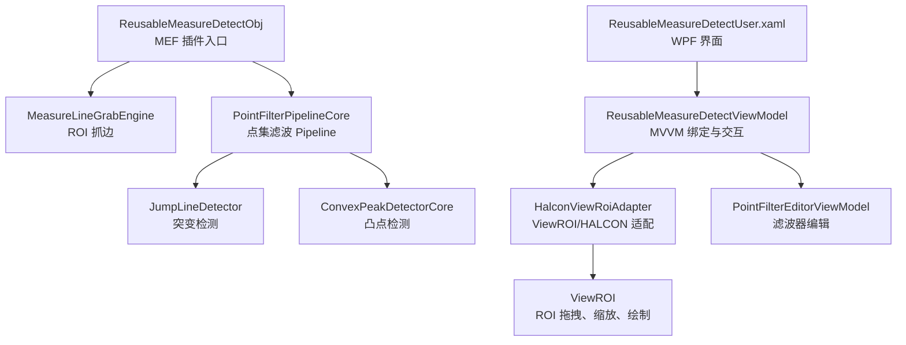

# Plugin.ReusableMeasureDetect 说明手册

## 1. 插件定位

`Plugin.ReusableMeasureDetect` 是按 `Plugin.MeasureLine` 的思路封装的可复用测量检测插件，目标是把“图像/点集输入、ROI 抓边、点集滤波、突变检测、凸点检测、结果输出、界面仿真”放到一个独立插件中。

插件运行时只依赖当前插件目录、`Frame_Core.pluginParams.ParamsReusableMeasureDetect` 参数类、HALCON 和框架的 `IPlugin/IPluginWpfView` 接口。除已存在的参数类外，不要求改动其他业务插件源码。

## 2. 总体架构

### 运行主流程

1. `ReusableMeasureDetectObj.ExecuteObj()` 进入运行。
2. 如果 `ImageSourceIndex=1`，从上游模块输出读取 `HObject` 图像。
3. 如果 `EnableMeasureGrab=true`，`MeasureLineGrabEngine.Run()` 使用 ROI 和 HALCON metrology 抓边，写入 `InputPoints` 和 `GrabOutput`。
4. `PointFilterPipelineCore.ApplyAndWriteOutput()` 对输入点运行滤波 Pipeline，写入 `FilterOutput`，并把当前选中步骤点集写入 `RuntimeDetectionPoints`。
5. 如果启用凸点，`ConvexPeakDetectorCore.DetectAndWriteOverlay()` 写入 `ConvexOutput`。
6. 如果启用突变，`JumpLineDetector.DetectAndWriteOverlay()` 写入 `JumpOutput`。
7. `WriteOutputParams()` 将 `GrabOutput`、`FilterOutput`、`ConvexOutput`、`JumpOutput`、`RuntimeDetectionPoints` 输出给流程。

## 3. 界面布局说明

界面使用深色 WPF 风格，主要区域如下：

- 左侧/上方：HALCON 图像显示与 ROI 拖拽，支持加载图片、适应显示、演示点仿真、ROI 重置。
- 参数页：按功能分组显示，不把所有参数堆在一个区域。
- 滤波页：滤波启用、预排序、添加/删除/调整滤波顺序、当前滤波器参数模板、输出步骤选择。
- 检测页：突变检测和凸点检测分开启用；启用项才参与运行和成功判定。
- 结果页：原始点、滤波点、凸点结果、突变结果、汇总结果分表显示。
- 底部状态栏：显示耗时、鼠标 Row/Col、当前像素灰度、图像大小、原始点数、滤波点数、运行状态。

帮助文本不在主参数区显示；说明内容放在本文档中。

## 4. 参数与输出对象

参数类在 `Frame_Core.pluginParams.ParamsReusableMeasureDetect` 中，插件内部只读取和写回这些字段。

### 输入与抓边参数

- `ho_Image`：当前输入图像，界面加载或上游模块提供。
- `ImageSourceIndex/ImageSourceModule/ImageSourceName`：上游图像来源配置。
- `EnableMeasureGrab`：是否使用 HALCON MeasureLine 抓边；关闭时必须已有 `InputPoints`。
- `EnableRoi/RoiCenterRow/RoiCenterCol/RoiAngleDeg/RoiHalfLength1/RoiHalfLength2/RoiPointNum`：旋转矩形 ROI 和采样点数。
- `MeasureSigma/MeasureThreshold/MeasureTransition/MeasureSelect/MeasureMinScore`：HALCON 测量边缘参数。
- `ScaleMean`：抓边前灰度开运算平滑尺寸。
- `EnablePointMedianReject/PointMedianRangeFactor`：抓边点法向中值离群剔除。

### 位置跟随参数

- `m_bUsePositionFollow`：是否启用位置跟随。
- `m_fBaseRow/m_fBaseCol/m_fBaseAngle`：基准位姿。
- `m_fCurrentRow/m_fCurrentCol/m_fCurrentAngle`：当前位姿。
- `m_bCurrentPoseValid`：当前位姿是否有效。
- `m_fFollowOffsetX/m_fFollowOffsetY/m_fFollowOffsetR`：运行时偏差输出。

### 滤波参数

- `PointFilterOptionsParam.Enable`：总滤波开关。
- `PreSortMode`：预排序模式，`None/Row/Col`。
- `FilterOrderCsv`：滤波器顺序，按 ID 保存。
- `SelectedStepIndex`：输出步骤，`-1` 表示自动最后一步。
- `ShowSelectedPointSet/DisplayCrossSize`：当前点集显示开关和十字大小。
- 各滤波器开关和参数：`Mean/Gaussian/Median/Bilateral/Guided/CurvatureFlow/Sobel/Laplacian/Gabor` 及各自半径、Sigma、步长、增强量。

### 检测参数

- `EnableJumpDetection`：启用突变检测。
- `JumpMode`：突变方向，`Row` 检测行方向突变，`Col` 检测列方向突变。
- `RowJumpThreshold/ColJumpThreshold`：主边簇阈值。
- `MainMaxFitPoints/SecondaryMaxFitPoints/MinFitPoints`：主副边拟合点数。
- `MaxFitError/MinTurnAngleDeg`：拟合误差和主副边夹角阈值。
- `RowMainAngleMinDeg/RowMainAngleMaxDeg/ColMainAngleMinDeg/ColMainAngleMaxDeg`：主边角度范围。
- `EnableConvexPeakDetection`：启用凸点检测。
- `EnableCornerPeakDetection`：启用传统角点凸点方法。
- `ConvexSmoothWindow/ConvexSupportWindow`：平滑窗口和左右支撑窗口。
- `ConvexMinPeakScore/ConvexMinProminence/ConvexMinTurnAngleDeg/ConvexMinSlopeDelta`：凸点候选筛选阈值。
- `ConvexOutlierRadius/ConvexOutlierMinNeighbors`：孤立点剔除参数。

### 输出对象

- `GrabOutput`：抓边状态、消息、原始点数、剔除点数、原始点和原始点十字 XLD。
- `FilterOutput`：Raw 点、每一步滤波点、当前选中步骤点、当前点十字 XLD。
- `JumpOutput`：突变主边、副边、交点、夹角、角度、拟合误差和显示 XLD。
- `ConvexOutput`：凸点 Row/Col、Score、突出度、坡度差、转角、拟合误差和显示 XLD。
- `RuntimeDetectionPoints`：最终参与检测的点集，来自 `FilterOutput.SelectedPoints`。

## 5. 类与函数说明

### 5.1 插件入口

| 文件 | 类/函数 | 作用 |
|---|---|---|
| `Plugin.ReusableMeasureDetect.cs` | `ReusableMeasureDetectObj` | MEF 插件入口，串联抓边、滤波、突变、凸点和输出。 |
| `Plugin.ReusableMeasureDetect.cs` | `ExecuteObj()` | 主运行函数；准备输出、读图、抓边、滤波、检测、写结果、触发完成事件。 |
| `Plugin.ReusableMeasureDetect.cs` | `IniObj()` | 初始化参数文件路径。 |
| `Plugin.ReusableMeasureDetect.cs` | `saveParams()` | 保存当前参数到模块参数文件。 |
| `Plugin.ReusableMeasureDetect.cs` | `SetParams()` | 框架加载参数后回灌参数对象。 |
| `Plugin.ReusableMeasureDetect.cs` | `GetResultParams()` | 将对象写入流程输出变量。 |
| `Plugin.ReusableMeasureDetect.cs` | `DisPoseObj()` | 释放参数内 HALCON 对象和事件引用。 |
| `Plugin.ReusableMeasureDetect.cs` | `EnsureParams()` | 确保参数为 `ParamsReusableMeasureDetect`。 |
| `Plugin.ReusableMeasureDetect.cs` | `SetInputParams()` | 从上游模块读取图像。 |
| `Plugin.ReusableMeasureDetect.cs` | `WriteOutputParams()` | 输出抓边、滤波、凸点、突变和运行点集。 |

### 5.2 WPF 界面与主 ViewModel

| 文件 | 类/函数 | 作用 |
|---|---|---|
| `WPF架构/ReusableMeasureDetectUser.xaml.cs` | `ReusableMeasureDetectUser` | WPF 视图壳，创建 ViewModel 并承接框架生命周期。 |
| `WPF架构/ReusableMeasureDetectUser.xaml.cs` | `BindPlugin()` | 将框架插件实例传给 ViewModel。 |
| `WPF架构/ReusableMeasureDetectUser.xaml.cs` | `RefreshBindings()` | 刷新界面绑定。 |
| `WPF架构/ReusableMeasureDetectUser.xaml.cs` | `RunFromHost()` | 转发运行命令。 |
| `WPF架构/ReusableMeasureDetectUser.xaml.cs` | `SaveFromHost()` | 转发保存命令。 |
| `WPF架构/ReusableMeasureDetectUser.xaml.cs` | `CloseFromHost()/BeforeClose()` | 释放界面资源。 |
| `WPF架构/ReusableMeasureDetectUser.xaml.cs` | `BeforeRun()/BeforeSave()` | 运行/保存前提交界面参数。 |
| `WPF架构/ReusableMeasureDetectUser.xaml.cs` | `AfterRun()/AfterSave()` | 运行/保存后刷新状态。 |
| `WPF架构/ReusableMeasureDetectUser.xaml.cs` | `OnPluginExecutedFromOutside()` | 外部流程运行后刷新界面。 |
| `WPF架构/ReusableMeasureDetectUser.xaml.cs` | `UserControl_Unloaded()` | WPF 卸载时释放 HALCON 窗口。 |
| `ViewModels/ReusableMeasureDetectViewModel.cs` | `ReusableMeasureDetectViewModel` | 主界面 MVVM，负责参数、命令、ROI、绘制、结果表格和状态栏。 |
| `ViewModels/ReusableMeasureDetectViewModel.cs` | `BindPlugin()` | 绑定插件和参数，初始化滤波编辑器和显示。 |
| `ViewModels/ReusableMeasureDetectViewModel.cs` | `RefreshBindings()` | 从参数刷新所有绑定和结果表。 |
| `ViewModels/ReusableMeasureDetectViewModel.cs` | `RunFromHost()` | 提交参数、执行插件、刷新结果和叠加显示。 |
| `ViewModels/ReusableMeasureDetectViewModel.cs` | `SaveFromHost()` | 保存参数并更新状态。 |
| `ViewModels/ReusableMeasureDetectViewModel.cs` | `LoadImage()` | 加载本地图像用于仿真。 |
| `ViewModels/ReusableMeasureDetectViewModel.cs` | `CloseFromHost()` | 释放 `HalconViewRoiAdapter` 和 `HWindowControl`。 |
| `ViewModels/ReusableMeasureDetectViewModel.cs` | `CommitToParams()` | 同步 ROI 与滤波 Pipeline 参数。 |
| `ViewModels/ReusableMeasureDetectViewModel.cs` | `InitRoiAdapter()` | 延迟创建并绑定 ROI/鼠标/重绘事件。 |
| `ViewModels/ReusableMeasureDetectViewModel.cs` | `OnMouseInfoChanged()` | 更新底部鼠标坐标、灰度、图像大小。 |
| `ViewModels/ReusableMeasureDetectViewModel.cs` | `OnRightMouseDown()` | 记录位置跟随菜单坐标和 ROI 角度。 |
| `ViewModels/ReusableMeasureDetectViewModel.cs` | `SetBasePose()/SetCurrentPose()` | 设置位置跟随基准位姿和当前位姿。 |
| `ViewModels/ReusableMeasureDetectViewModel.cs` | `ResetRoiFromPoints()` | 根据当前点集包围盒重置 ROI。 |
| `ViewModels/ReusableMeasureDetectViewModel.cs` | `OnRoiChanged()` | ROI 拖拽后同步参数并按事件类型重绘或运行。 |
| `ViewModels/ReusableMeasureDetectViewModel.cs` | `RefreshFollowOffsetText()` | 计算并显示 X/Y/R 跟随偏差。 |
| `ViewModels/ReusableMeasureDetectViewModel.cs` | `GenerateDemoPointsAndRun()` | 生成演示直角点集并运行仿真。 |
| `ViewModels/ReusableMeasureDetectViewModel.cs` | `RenderOverlay()` | 刷新图像、ROI 和算法叠加。 |
| `ViewModels/ReusableMeasureDetectViewModel.cs` | `DrawOverlayObjects()` | 绘制原始点、滤波点、主副边、交点、凸点。 |
| `ViewModels/ReusableMeasureDetectViewModel.cs` | `DrawFollowRoi()` | 绘制绿色跟随后的运行 ROI。 |
| `ViewModels/ReusableMeasureDetectViewModel.cs` | `RefreshResultRows()` | 生成结果页表格数据。 |
| `ViewModels/ReusableMeasureDetectViewModel.cs` | `UpdateStatusBarText()` | 更新底部状态栏。 |
| `ViewModels/ReusableMeasureDetectViewModel.cs` | `BuildStatusText()` | 生成顶部运行详情文本。 |
| `ViewModels/ReusableMeasureDetectViewModel.cs` | `Normalize*/Clamp*/Format*()` | 参数合法化和显示格式化工具函数。 |
| `ViewModels/ReusableMeasureDetectViewModel.cs` | `PointResultRow/KeyValueResultRow` | 结果表格行模型。 |

### 5.3 HALCON 与 ROI 适配

| 文件 | 类/函数 | 作用 |
|---|---|---|
| `Services/HalconViewRoiAdapter.cs` | `HalconViewRoiAdapter` | 隔离 ViewROI/HALCON 细节，给 ViewModel 提供简洁接口。 |
| `Services/HalconViewRoiAdapter.cs` | `RefreshFromParams()` | 从参数刷新图像、ROI 和显示区域。 |
| `Services/HalconViewRoiAdapter.cs` | `Repaint()` | 重绘当前窗口。 |
| `Services/HalconViewRoiAdapter.cs` | `GetActiveRectangleRoi()` | 获取当前旋转矩形 ROI。 |
| `Services/HalconViewRoiAdapter.cs` | `UpdateParamsFromActiveRoi()` | 将 ROI 坐标、角度、尺寸和点数写回参数。 |
| `Services/HalconViewRoiAdapter.cs` | `Dispose()` | 解除事件并释放本类拥有的显示图。 |
| `Services/HalconViewRoiAdapter.cs` | `EnsureRectangleRoi()` | 保证 ViewROI 中存在矩形 ROI 并同步参数。 |
| `Services/HalconViewRoiAdapter.cs` | `RefreshDisplayImage()` | 准备显示图；彩色图转灰度副本。 |
| `Services/HalconViewRoiAdapter.cs` | `DisposeDisplayImage()` | 只释放本类创建的灰度显示图。 |
| `Services/HalconViewRoiAdapter.cs` | `RepaintWithoutImage()` | 无图时按点集和 ROI 设置显示范围。 |
| `Services/HalconViewRoiAdapter.cs` | `SetPartFromData()` | 根据数据包围盒设置 HALCON 视野。 |
| `Services/HalconViewRoiAdapter.cs` | `OnMouseMove()/OnMouseDown()/OnMouseUp()` | 转换 HALCON 鼠标事件。 |
| `Services/HalconViewRoiAdapter.cs` | `BuildMouseInfo()` | 读取图像坐标、灰度和图像大小。 |
| `Services/HalconViewRoiAdapter.cs` | `GetMousePositionFromViewRoi()` | 使用 `GetMposition` 按 ViewROI 状态取图像坐标。 |
| `Services/HalconViewRoiAdapter.cs` | `FormatGrayValue()/HasValidImage()` | 灰度格式化和图像校验。 |
| `Services/HalconViewRoiAdapter.cs` | `ReusableMeasureMouseInfo` | 鼠标状态栏数据对象。 |

`ViewROI` 目录是从已有工具复制的 ROI 基础设施，负责窗口拖拽、缩放、ROI 控制点、ROI 绘制。当前插件只通过 `HalconViewRoiAdapter` 调用它，不直接把业务逻辑写进 `ViewROI`。

### 5.4 抓边、跟随、检测核心

| 文件 | 类/函数 | 作用 |
|---|---|---|
| `Core/MeasureLineGrabEngine.cs` | `MeasureLineGrabEngine` | HALCON MeasureLine 抓边执行器。 |
| `Core/MeasureLineGrabEngine.cs` | `Run()` | 根据 ROI 和 metrology 参数抓边，写 `InputPoints/GrabOutput`。 |
| `Core/MeasureLineGrabEngine.cs` | `WriteRawCross()` | 生成原始抓边点十字 XLD。 |
| `Core/MeasureLineGrabEngine.cs` | `SortAndMedianReject()` | 按 ROI 坐标投影排序并剔除法向离群点。 |
| `Core/MeasureLineGrabEngine.cs` | `HasValidImage()` | 判断 `HObject` 是否为有效图像。 |
| `Core/MeasureLineGrabEngine.cs` | `NormalizeTransition()/NormalizeSelect()/NormalizeInterpolation()/NormalizeBoolString()` | 规范化 HALCON 参数。 |
| `Core/MeasureLineGrabEngine.cs` | `Clamp01()/Median()/Clone()/ClonePoint()` | 数值限制、统计和点集深拷贝工具。 |
| `Core/MeasureLineGrabEngine.cs` | `ProjectedPoint` | ROI 主轴/法向投影缓存。 |
| `Core/ReusableMeasureRoiFollower.cs` | `ReusableMeasureRoiFollower` | 基于基准/当前位姿计算刚体跟随。 |
| `Core/ReusableMeasureRoiFollower.cs` | `Transform()` | 将 ROI 中心和角度变换到当前位姿。 |
| `Core/ReusableMeasureRoiFollower.cs` | `ToRad()` | 角度转弧度。 |
| `Core/JumpLineDetector.cs` | `JumpLineDetector` | 突变主副边检测器。 |
| `Core/JumpLineDetector.cs` | `DetectAndWriteOverlay()` | 执行突变检测并写结果与 XLD。 |
| `Core/JumpLineDetector.cs` | `BuildInputPoints()` | 优先使用滤波输出点，回退原始点。 |
| `Core/JumpLineDetector.cs` | `FindJumpCandidates()` | 搜索主边簇和副边候选。 |
| `Core/JumpLineDetector.cs` | `BuildMainRangeCluster()` | 根据阈值收敛主边点簇。 |
| `Core/JumpLineDetector.cs` | `BuildSecondarySideCandidateSets()` | 按主边均值两侧生成副边候选。 |
| `Core/JumpLineDetector.cs` | `SelectFitIndexes()` | 选择主副边拟合点。 |
| `Core/JumpLineDetector.cs` | `TryBuildJumpDebugInfo()` | 拟合直线、求交点、做角度/误差校验。 |
| `Core/JumpLineDetector.cs` | `FitLine()` | HALCON 直线拟合并计算误差。 |
| `Core/JumpLineDetector.cs` | `WriteResultValues()` | 写入主边、副边、交点和显示对象。 |
| `Core/JumpLineDetector.cs` | `Intersect()/EstimateJumpSplitIndex()/IndexSpread()/Average()/Value()` | 突变几何和候选评分工具。 |
| `Core/JumpLineDetector.cs` | `Normalize()/DistanceToLine()/UndirectedAngle()/GetAngleLxAbsDeg()/IsAngleInRange0To90()/Clamp0To90()` | 几何计算和阈值工具。 |
| `Core/JumpLineDetector.cs` | `JumpCandidate/JumpDebugInfo/Point2/LineFit` | 突变候选和拟合中间结构。 |
| `Core/ConvexPeakDetectorCore.cs` | `ConvexPeakDetectorCore` | 传统角点凸点检测器。 |
| `Core/ConvexPeakDetectorCore.cs` | `DetectAndWriteOverlay()` | 执行凸点检测并写结果与 XLD。 |
| `Core/ConvexPeakDetectorCore.cs` | `BuildInputPoints()` | 优先使用滤波输出点；点数不足时回退原始点。 |
| `Core/ConvexPeakDetectorCore.cs` | `RemoveIsolatedOutliers()` | 按邻域数量剔除孤立点。 |
| `Core/ConvexPeakDetectorCore.cs` | `Smooth()` | 滑动平均平滑点链。 |
| `Core/ConvexPeakDetectorCore.cs` | `BuildIndexRange()` | 生成左右拟合窗口索引。 |
| `Core/ConvexPeakDetectorCore.cs` | `ScoreCandidate()` | 综合转角、突出度、坡度差和误差打分。 |
| `Core/ConvexPeakDetectorCore.cs` | `FitLine()` | HALCON 直线拟合并计算误差。 |
| `Core/ConvexPeakDetectorCore.cs` | `WriteConvexResult()` | 写入凸点结果、左右边和显示 XLD。 |
| `Core/ConvexPeakDetectorCore.cs` | `WriteLine()/BuildLineXld()/GetAngleLxAbsDeg()` | 输出线段和角度工具。 |
| `Core/ConvexPeakDetectorCore.cs` | `Normalize()/Distance()/DistanceToLine()/UndirectedAngle()/DirectionSlope()/Clamp0To90()` | 凸点几何计算工具。 |
| `Core/ConvexPeakDetectorCore.cs` | `ConvexCandidate/Point2/LineFit` | 凸点候选和拟合中间结构。 |

### 5.5 点集滤波模块

| 文件 | 类/函数 | 作用 |
|---|---|---|
| `PointFilters/Core/PointFilterPipelineCore.cs` | `IPointFilterTool` | 滤波算法接口，便于后续抽成公共库。 |
| `PointFilters/Core/PointFilterPipelineCore.cs` | `PointFilterParameterDescriptor` | 参数字段描述，供动态模板绑定。 |
| `PointFilters/Core/PointFilterPipelineCore.cs` | `PointFilterToolDescriptor` | 滤波器元数据。 |
| `PointFilters/Core/PointFilterPipelineCore.cs` | `PointFilterPipelineCore` | 注册滤波器并运行 Pipeline。 |
| `PointFilters/Core/PointFilterPipelineCore.cs` | `GetToolDescriptors()` | 返回滤波器元数据。 |
| `PointFilters/Core/PointFilterPipelineCore.cs` | `BuildInputOrDemoPoints()` | 获取输入点或生成演示点。 |
| `PointFilters/Core/PointFilterPipelineCore.cs` | `ApplyAndWriteOutput()` | 运行 Pipeline 并写 `FilterOutput/RuntimeDetectionPoints`。 |
| `PointFilters/Core/PointFilterPipelineCore.cs` | `ApplyWithSteps()` | 返回每一步滤波结果。 |
| `PointFilters/Core/PointFilterPipelineCore.cs` | `SelectStepToOutput()` | 切换当前输出步骤。 |
| `PointFilters/Core/PointFilterPipelineCore.cs` | `WriteSelectedStep()` | 写选中步骤并生成十字 XLD。 |
| `PointFilters/Core/PointFilterPipelineCore.cs` | `BuildOrder()/ResolveSelectedStepIndex()/NormalizeSortMode()/SortPoints()` | Pipeline 顺序、步骤和排序工具。 |
| `PointFilters/Core/PointFilterPipelineCore.cs` | `Mean()/Gaussian()/Median()/Bilateral()/Guided()/CurvatureFlow()/EdgeEnhance()/GaborLike()` | 具体滤波算法。 |
| `PointFilters/Core/PointFilterPipelineCore.cs` | `Window()/BuildPointCross()/Lerp()/MedianValue()/Distance()/Clone()/ClonePoint()` | 通用滤波工具。 |
| `PointFilters/Core/PointFilterPipelineCore.cs` | `PointFilterStepResult` | 单步滤波结果。 |
| `PointFilters/Core/PointFilterPipelineCore.cs` | `MeanPointFilterTool` 等 9 个工具类 | 将具体算法和 Options 参数接入统一接口。 |
| `PointFilters/ViewModels/PointFilterEditorViewModel.cs` | `PointFilterEditorViewModel` | 滤波编辑器 MVVM。 |
| `PointFilters/ViewModels/PointFilterEditorViewModel.cs` | `Attach()/CommitToOptions()/RefreshSteps()/GetSelectedPoints()/RefreshFromPipelineOutput()` | 宿主调用接口。 |
| `PointFilters/ViewModels/PointFilterEditorViewModel.cs` | `LoadFromOptions()/LoadFilterPipelineFromOptions()/AddFilterFromOptions()` | 从参数恢复界面 Pipeline。 |
| `PointFilters/ViewModels/PointFilterEditorViewModel.cs` | `AddSelectedFilter()/DeleteSelectedFilter()/MoveSelectedFilter()` | UI 增删移动滤波器。 |
| `PointFilters/ViewModels/PointFilterEditorViewModel.cs` | `RefreshAvailableFilters()/SelectStepFromOptions()/PipelineContains()/IsSelectedFilter()` | 列表和选中状态管理。 |
| `PointFilters/ViewModels/PointFilterEditorViewModel.cs` | `RefreshSelectedParameterFields()` | 动态生成当前滤波器参数字段。 |
| `PointFilters/ViewModels/PointFilterEditorViewModel.cs` | `CreateFilterItem()` | 创建具体滤波器列表项类型，支持 WPF 模板选择。 |
| `PointFilters/ViewModels/PointFilterEditorViewModel.cs` | `ParseFilterOrder()/FindFilterDescriptor()/IsFilterEnabled()/SetFilterEnabled()` | 参数读写辅助函数。 |
| `PointFilters/ViewModels/PointFilterEditorViewModel.cs` | `FilterItemViewModel` 及子类 | 每种滤波器的列表项类型。 |
| `PointFilters/ViewModels/PointFilterEditorViewModel.cs` | `FilterStepItemViewModel` | 输出步骤下拉项。 |
| `PointFilters/ViewModels/PointFilterEditorViewModel.cs` | `FilterParameterFieldViewModel` | 通过反射绑定单个滤波参数。 |
| `PointFilters/Controls/FilterUserControl.xaml.cs` | `FilterUserControl` | 滤波参数控件代码隐藏，只负责初始化 XAML。 |
| `PointFilters/Abstractions/IPointFilterEditor.cs` | `IPointFilterEditor` | 滤波编辑器接口，后续抽公共库时保留。 |

### 5.6 通用 MVVM 与控件

| 文件 | 类/函数 | 作用 |
|---|---|---|
| `Controls/NumericBox.cs` | `NumericBox` | 深色数值输入控件，支持范围、步进、键盘和粘贴校验。 |
| `Controls/NumericBox.cs` | `OnValueChanged()/OnRangeChanged()/OnDecimalPlacesChanged()` | 依赖属性变化处理。 |
| `Controls/NumericBox.cs` | `CreateButton()/Step()/ApplyValue()/CommitText()/Clamp()` | 控件内部 UI、步进、格式化和范围限制。 |
| `Controls/NumericBox.cs` | `OnPreviewTextInput()/OnPreviewKeyDown()/OnPaste()` | 输入合法性校验。 |
| `ViewModels/BindableBase.cs` | `BindableBase` | 主界面属性通知基类。 |
| `ViewModels/RelayCommand.cs` | `RelayCommand<T>` | 主界面 ICommand 封装。 |
| `PointFilters/ViewModels/BindableBase.cs` | `BindableBase` | 滤波编辑器属性通知基类。 |
| `PointFilters/ViewModels/RelayCommand.cs` | `RelayCommand<T>` | 滤波编辑器 ICommand 封装。 |

## 6. 内存与 HALCON 对象规则

- `ParamsReusableMeasureDetect.Dispose()` 负责释放参数拥有的图像和输出对象。
- 每次运行前 `ReleaseOutputs()` 会清理旧的输出 XLD，避免显示旧结果。
- `MeasureLineGrabEngine.Run()` 中创建的 `metrologyHandle`、临时 `contours`、临时灰度图在 `finally` 中释放。
- `HalconViewRoiAdapter` 不复制原始灰度图；只有彩色图转灰度显示时创建副本，并用 `displayImageOwned` 标记释放责任。
- `PointFilterPipelineCore.BuildPointCross()` 返回的 XLD 由 `FilterOutput.Clear()/Dispose()` 释放。
- `JumpLineDetector` 和 `ConvexPeakDetectorCore` 写入的 XLD 由各自输出对象 `Clear()/Dispose()` 释放。
- ViewModel 绘制临时点集十字时使用 `try/finally` 立即释放临时对象。

## 7. 使用与调试步骤

1. 在界面点击“加载图片”或从上游模块提供 `HObject` 图像。
2. 启用 ROI 后拖拽旋转矩形，设置抓边方向、宽度和点数。
3. 需要仿真时点击“演示点”，插件会生成水平主边和垂直副边点集并运行。
4. 在滤波页添加需要的滤波器，选择“自动最后一步”或指定某一步参与检测。
5. 分别启用“突变检测”和“凸点检测”；两者独立，关闭的检测不会参与成功判定。
6. 查看结果页中的原始点、滤波点、凸点、突变和汇总输出。
7. 底部状态栏用于现场调试：确认鼠标坐标、灰度、图像尺寸、点数和耗时是否正常。

## 8. 关键设计约束

- ROI 只用于 MeasureLine 抓边阶段；滤波 Pipeline 不再做二次 ROI 筛点，避免副边点被误删。
- 滤波器通过 `IPointFilterTool` 注册，参数通过 `PointFilterParameterDescriptor` 和 WPF 模板绑定，后续可直接拆到公共库。
- 突变检测和凸点检测是两个独立功能，必须通过各自启用开关控制。
- ViewModel 只做界面状态和调用编排，算法放在 `Core` 和 `PointFilters/Core`。
- `ViewROI` 作为基础显示/ROI 库使用，不在里面写业务检测逻辑。

